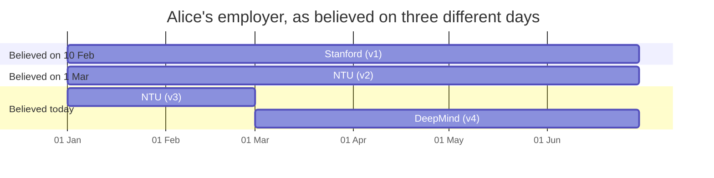

*[Knowledge Graphs: From Concept to Production](../README.md) · Day 16 of 23 · Arc 4 — Time, Procedure and Reason*

# Day 16 — Temporal Graphs: Two Clocks on Every Fact

> **Today's one idea:** Every fact carries two time windows — when it was true *in the world* (valid time) and when the graph *believed* it (record time). Changes close windows instead of deleting edges, so the graph can answer "what was true on D1, as we knew it on D2?"
> **Reading time:** ~40 min · **Prereqs:** [Day 3](day-03-property-graphs-in-practice.md), [Day 5](day-05-querying-cypher-sparql.md), [Day 13](day-13-schema-design-patterns.md), [Day 14](day-14-production-concerns.md)
> **Primary source for today:** Rasmussen, Preston, Pavlo Paliychuk, Travis Beauvais, Jack Ryan, and Daniel Chalef. "Zep: A Temporal Knowledge Graph Architecture for Agent Memory." arXiv:2501.13956, 2025. §2.1 (the two timelines) and §2.2.3 ("Temporal Extraction and Edge Invalidation").
> **Before you start:** Recall Day 15's "done" test — one sentence, no looking. What kind of question did your capstone agent have to answer that plain vector RAG fails on? Now ask yourself: could it answer that same question *as of last month*?

---

## The hook (2–4 min)

Remember Alice Chen from [Day 14's hook](day-14-production-concerns.md)? The graph said she worked at *Stanford*; the source was corrected to *NTU*. Day 14's `KGReconciler` fixed it the obvious way — it deleted the wrong edge.

Three weeks later, a compliance reviewer opens a ticket:

> "On 10 February your agent emailed Alice Chen at a Stanford address with confidential NTU project details. Was that an agent bug?"

You query the graph. It says Alice works at NTU — and has nothing else to say. The Stanford edge is gone. You cannot tell whether the agent ignored correct data (a bug) or faithfully used wrong data (a data problem). Same email, two completely different root causes, and the evidence that would separate them was destroyed by the fix.

This is not a knowledge-graph quirk. A hospital reviewing a prescription needs the allergy list *as the prescriber saw it*, not as corrected later. A bank re-filing a regulatory report needs the trade *as it was reported*, not as amended. Every system that has to justify a past action needs the past — including its own past mistakes.

---

## Building the intuition (10–15 min)

### A newspaper has two dates on every story

Pick up an old newspaper. The story says: *"Alice Chen joins DeepMind, effective 1 March."* The paper itself is dated *10 March*.

- **1 March** is when the fact became true in the world.
- **10 March** is when the newspaper learned it and printed it.

Now suppose the paper got something wrong. A newspaper doesn't pulp yesterday's edition — it prints a *correction* in today's. Yesterday's edition still exists in the archive, wrong and all. That archive is the whole point: you can always pull out the 10 February edition and see exactly what readers were told that day.

A temporal graph is a newspaper archive for facts. It keeps two clocks:

| Clock | Asks | Martin Fowler calls it | Changes when… |
|---|---|---|---|
| **Valid time** | When was this true in the world? | *actual history* | the world changes |
| **Record time** | When did the graph believe it? | *record history* | the graph's belief changes |

### Alice's year, version by version

Three things happen:

1. **5 Jan** — we record "Alice works at Stanford since 1 Jan." (It's wrong.)
2. **20 Feb** — a correction: it was NTU all along.
3. **10 Mar** — we learn Alice moved to DeepMind *effective 1 March*.

We never edit a version. We only **retire** versions (stamp them with the date we stopped believing them) and **write** new ones:

| Version | Employer | Valid from | Valid to | Recorded at | Retired at |
|---|---|---|---|---|---|
| v1 | Stanford | 1 Jan | *(open)* | 5 Jan | 20 Feb |
| v2 | NTU | 1 Jan | *(open)* | 20 Feb | 10 Mar |
| v3 | NTU | 1 Jan | 1 Mar | 10 Mar | *(still believed)* |
| v4 | DeepMind | 1 Mar | *(open)* | 10 Mar | *(still believed)* |

Read the table one "edition" at a time — each section below is what the graph believed on one day:



*(A bar running to the right edge means "open-ended — no known end yet".)*

Before reading on, answer these from the table alone:

- Where did Alice work on 15 Feb? → **NTU** (today's belief).
- On 10 Feb, where did the *graph say* she worked on 10 Feb? → **Stanford** (v1). The agent used the data it had. Not an agent bug — a data bug, now provably so.
- On 5 Mar, where did the graph think she worked that day? → **NTU** (v2) — even though in reality she'd already left. The graph wasn't lying; it just hadn't heard yet.

Three different questions, and every one of them is the same act: pick a column on the record clock (*which edition?*), then pick a point on the valid clock (*which day in that edition?*).

### The surprise: corrections and real changes are the same move

Look at what happened on 20 Feb (a correction) and on 10 Mar (a real-world change). Mechanically, they're identical: retire the versions we no longer believe, write the versions we now believe. The difference is only in *what we now believe about the valid clock*:

- **Correction** (20 Feb): the new version covers the *same* valid period as the old one. Stanford never appears in any current answer, for any date — it was never true.
- **Real change** (10 Mar): the old employer survives with its valid window *closed* (NTU until 1 Mar). It's still true — for the past.

If you predicted "corrections touch the record clock and real changes touch the valid clock", you're half right, and the half that's wrong is the most common bug in temporal systems. We'll name it below.

---

## The formal picture (10–15 min)

### Definitions

Every time-sensitive edge carries four timestamps, forming two **closed-open intervals** — the start is included, the end is not:

- **Valid interval** `[valid_from, valid_to)` — the period the fact holds in the world. `valid_to` missing = *no known end*.
- **Record interval** `[recorded_at, expired_at)` — the period the graph believed this version. `expired_at` missing = *still believed*.

Closed-open means a fact valid `[1 Jan, 1 Mar)` and its successor valid `[1 Mar, …)` meet exactly at 1 March with no gap and no overlap. On 1 March, Alice works at DeepMind and only DeepMind.

Two rules make the whole thing work:

1. **Record time is append-only.** The only write you ever make to an existing version is setting its `expired_at`. Everything else is a new version.
2. **One query, two dials.** Every read takes a `known_at` (which edition) and a `valid_at` (which day in it). "Current truth" is just `known_at = now, valid_at = now`.

The Zep paper uses exactly this structure for agent memory: timeline **T** (`t_valid`, `t_invalid`) for events in the world, and timeline **T′** (`t′_created`, `t′_expired`) for ingestion. When a new fact contradicts an old edge, Zep *invalidates* the old edge — it is never deleted (§2.2.3).

### Same idea, seven real systems

| System | Domain | Valid clock | Record clock | What it shows |
|---|---|---|---|---|
| **Graphiti / Zep** | Agent memory (on Neo4j) | `t_valid` / `t_invalid` on edges | `t′_created` / `t′_expired` | Contradicted facts are invalidated, not deleted |
| **XTDB** | Bitemporal database | `_valid_from` / `_valid_to` | `_system_from` / `_system_to` | All four columns on every row, closed-open intervals, SQL:2011-style syntax |
| **MariaDB bitemporal tables** | SQL:2011 in practice | `PERIOD FOR application_time` | `WITH SYSTEM VERSIONING` | `UPDATE … FOR PORTION OF` edits application (valid) time only — system time is never yours to write |
| **openEHR** | Electronic health records | Clinical context time (when the clinician acted) | `time_committed` | Corrections become new versions grouped in a change set |
| **ABN AMRO trade store** (MarkLogic) | Banking / regulatory reporting | Trade events | Bitemporal record | Trades can be "rewound" for audit (vendor case study) |
| **Wikidata** | Public KG | Qualifiers: start time (P580), end time (P582) | Only in page revision history | Valid time alone, as data |
| **Datomic** | Database | *(none built in)* | `as-of`, `since`, `history` | Record time alone — you must model valid time yourself |

The last two rows are the useful contrast: real systems often give you **one** clock. Wikidata can tell you Berlin's population in 2005; it can't (as data) tell you what Wikidata *said* in 2015. Datomic can tell you what the database said last Tuesday; it can't tell you when a fact was true unless you store that yourself.

### Building it in Neo4j

Neo4j has no built-in bitemporality, so you add the four properties to relationships yourself — this is [Day 3's](day-03-property-graphs-in-practice.md) "properties live on edges" paying off. The edge is the thing that's time-bounded: Alice still exists, NTU still exists; it's *her working there* that started and stopped.

```python
# pip install neo4j        (Neo4j 5.x running locally)
from datetime import datetime, timezone
from neo4j import GraphDatabase

URI, AUTH = "bolt://localhost:7687", ("neo4j", "password")

def t(day: str) -> datetime:
    """'2026-03-01' -> UTC datetime. Always store UTC."""
    return datetime.fromisoformat(day).replace(tzinfo=timezone.utc)

RETIRE = """
MATCH (:Person {name: $person})-[r:WORKS_AT]->()
WHERE r.expired_at IS NULL
SET r.expired_at = $now
"""

WRITE = """
MATCH (p:Person {name: $person})
MERGE (o:Org {name: $org})
CREATE (p)-[:WORKS_AT {valid_from: $vf, valid_to: $vt, recorded_at: $now}]->(o)
"""  # a null $vt is simply not stored: "no known end"

def believe(session, person: str, versions: list[tuple[str, datetime, datetime | None]],
            now: datetime) -> None:
    """Replace our whole current belief about where `person` works.
    Corrections and real-world changes both come through here; they differ only
    in the valid windows inside `versions`."""
    def work(tx):
        tx.run(RETIRE, person=person, now=now).consume()
        for org, vf, vt in versions:
            tx.run(WRITE, person=person, org=org, vf=vf, vt=vt, now=now).consume()
    session.execute_write(work)   # retire + write commit together, or not at all

AS_OF = """
MATCH (:Person {name: $person})-[r:WORKS_AT]->(o:Org)
WHERE r.recorded_at <= $known_at
  AND (r.expired_at IS NULL OR $known_at < r.expired_at)   // which edition?
  AND r.valid_from <= $valid_at
  AND (r.valid_to IS NULL OR $valid_at < r.valid_to)       // which day in it?
RETURN o.name AS org
"""

with GraphDatabase.driver(URI, auth=AUTH) as driver, driver.session() as s:
    s.run("MATCH (n) WHERE n:Person OR n:Org DETACH DELETE n")   # scratch DB only
    s.run("CREATE (:Person {name: 'Alice Chen'})")

    believe(s, "Alice Chen", [("Stanford", t("2026-01-01"), None)], now=t("2026-01-05"))
    believe(s, "Alice Chen", [("NTU", t("2026-01-01"), None)], now=t("2026-02-20"))      # correction
    believe(s, "Alice Chen", [("NTU", t("2026-01-01"), t("2026-03-01")),
                              ("DeepMind", t("2026-03-01"), None)], now=t("2026-03-10"))  # real change

    now = datetime.now(timezone.utc)
    for valid_at, known_at in [(t("2026-02-15"), now),
                               (t("2026-02-10"), t("2026-02-10")),
                               (t("2026-03-05"), t("2026-03-05"))]:
        rows = s.run(AS_OF, person="Alice Chen", valid_at=valid_at, known_at=known_at)
        print(valid_at.date(), "as known on", known_at.date(), "->", [r["org"] for r in rows])
# 2026-02-15 as known on <today> -> ['NTU']
# 2026-02-10 as known on 2026-02-10 -> ['Stanford']
# 2026-03-05 as known on 2026-03-05 -> ['NTU']
```

Three things to notice:

- `believe()` retires *all* current versions and rewrites the belief. That keeps the teaching code honest; in production you'd retire only the versions that changed.
- The compliance question from the hook is now one call: `valid_at = known_at = 10 Feb` → Stanford. Data bug, not agent bug.
- Once your graph has thousands of these edges, index the filter: `CREATE INDEX works_at_valid IF NOT EXISTS FOR ()-[r:WORKS_AT]-() ON (r.valid_from)`.

---

## Where it breaks / what it is not (3–5 min)

**"We have `updated_at`, so we're temporal."** One timestamp is one clock. It can't answer "what did we believe on 1 March about where Alice worked on 1 February?" — that question needs both intervals.

**"Invalidation means setting `valid_to`."** This is the bug the intuition section warned about. If on 10 March you just `SET r.valid_to = 1 Mar` on the existing NTU edge, today's answers are right — but you've silently rewritten what the graph believed on 5 March. The 5 March edition now claims you already knew she'd left. Changing a version in place is changing the past. Retire and rewrite instead.

**"As of D" is not one query.** It's two dials. "What was true on D?" (`valid_at = D`, `known_at = now`) and "what did we know on D?" (`known_at = D`, `valid_at = D`) give different answers whenever a correction arrived later — that's exactly the Alice-on-5-March case.

**A missing end is not "true forever".** Recall [Day 1's Open World Assumption](day-01-what-is-a-knowledge-graph.md): absence of a fact isn't a fact. No `valid_to` means "no evidence it has ended", not "it will never end". This matters for Day 14's reconciler — see Exercise 4.

**Neo4j won't stop overlapping windows.** XTDB and SQL:2011 manage periods for you; in Neo4j, nothing prevents two "current" NTU versions with overlapping valid windows. You need a check (Exercise 3).

**Boundaries are where the bugs live.** Use `<=` on starts and `<` on ends, everywhere, always. Mixing conventions gives you a day on which Alice works at two places or none. Store UTC — a "valid from 1 March" in two time zones is two different instants.

**Not everything needs two clocks.** A person's date of birth doesn't change; a citation graph rarely needs record time. Pay the query complexity only for facts that change *and* that someone will ask about after the fact.

**This is not temporal KG embeddings.** Research on models like TTransE learns time-aware vectors to *predict* missing facts — [Day 11's](day-11-kg-embeddings.md) world, extended with time. Today is about *storing and querying* time correctly. Different problem, same word.

---

## Try it yourself (5–10 min)

### Exercise 1 — Retrieval (close the page first)

Without looking: (a) name the two clocks and what each one records; (b) explain, in terms of *which versions get written*, how a correction differs from a real-world change; (c) write the four `WHERE` conditions of the as-of query from memory.

<details>
<summary>Hint</summary>
Think of the newspaper: the date of the event, and the date of the edition. Then think about what survives in today's edition after a correction vs. after a move.
</details>

<details>
<summary>Solution</summary>

(a) **Valid time** — when the fact held in the world. **Record time** — when the graph believed this version.

(b) Both retire the current versions (set `expired_at`) and write new ones — the record clock is touched the same way in both. A **correction** writes a replacement covering the same valid period, so the wrong value never appears in any current answer. A **real change** writes the old value back with its valid window *closed*, plus the new value from the change date — the old value stays true for the past.

(c) `recorded_at <= $known_at`, `(expired_at IS NULL OR $known_at < expired_at)`, `valid_from <= $valid_at`, `(valid_to IS NULL OR $valid_at < valid_to)`. If you mixed up `<` and `<=`, redo the closed-open rule before moving on.
</details>

### Exercise 2 — Direct application: a medication safety review

A hospital patient record (an openEHR-style system) holds `(:Patient {id: 'P-17'})-[:HAS_ALLERGY]->(:Substance)`.

- **3 Feb** — a nurse records an allergy to *penicillin*, onset 1 Feb.
- **10 Feb** — a doctor prescribes *amoxicillin* (a penicillin-class antibiotic).
- **20 Feb** — the record is corrected: the allergy is to *sulfonamides*, onset 1 Feb. The penicillin entry was a data-entry error.

A safety review asks: *"When the prescription was written, did the record show an allergy that conflicts with amoxicillin?"*

Write the Cypher (or adapt `believe()`) to load these versions, then write the query the reviewer must run. Give the answer for `valid_at = known_at = 10 Feb`, and for `valid_at = 10 Feb, known_at = today`. Which one is the fair basis for judging the doctor?

<details>
<summary>Hint</summary>
The 20 Feb event is a correction, not a real change. Which valid window does the replacement carry? Then ask: what did the doctor see on 10 Feb?
</details>

<details>
<summary>Solution</summary>

Versions:

| Version | Substance | Valid from | Valid to | Recorded at | Retired at |
|---|---|---|---|---|---|
| a1 | Penicillin | 1 Feb | *(open)* | 3 Feb | 20 Feb |
| a2 | Sulfonamides | 1 Feb | *(open)* | 20 Feb | *(still believed)* |

```cypher
// load (run once each; $now is the recording date)
MATCH (p:Patient {id: 'P-17'}) MERGE (s:Substance {name: 'Penicillin'})
CREATE (p)-[:HAS_ALLERGY {valid_from: datetime('2026-02-01T00:00:00Z'),
                          recorded_at: datetime('2026-02-03T00:00:00Z')}]->(s);

MATCH (:Patient {id: 'P-17'})-[r:HAS_ALLERGY]->() WHERE r.expired_at IS NULL
SET r.expired_at = datetime('2026-02-20T00:00:00Z');

MATCH (p:Patient {id: 'P-17'}) MERGE (s:Substance {name: 'Sulfonamides'})
CREATE (p)-[:HAS_ALLERGY {valid_from: datetime('2026-02-01T00:00:00Z'),
                          recorded_at: datetime('2026-02-20T00:00:00Z')}]->(s);

// the reviewer's query
MATCH (:Patient {id: $patient})-[r:HAS_ALLERGY]->(s:Substance)
WHERE r.recorded_at <= $known_at AND (r.expired_at IS NULL OR $known_at < r.expired_at)
  AND r.valid_from  <= $valid_at AND (r.valid_to   IS NULL OR $valid_at < r.valid_to)
RETURN s.name
```

- `valid_at = known_at = 10 Feb` → **Penicillin**. The record the doctor saw showed a conflicting allergy. The prescription was a genuine safety event *at the time* — the review should ask why the alert was overridden or missed.
- `valid_at = 10 Feb, known_at = today` → **Sulfonamides**. Today's truth: the patient was never penicillin-allergic, so there was no clinical harm.

Both answers matter, but the **first** is the fair basis for judging the doctor's decision — you judge a decision by what was knowable when it was made. That sentence is the foundation of Day 19.
</details>

### Exercise 3 — Stretch: catch overlapping windows

Neo4j won't enforce it, so write a query that finds any person with **two currently believed** `WORKS_AT` versions whose **valid windows overlap**. Then decide: is an overlap always an error?

<details>
<summary>Hint</summary>
Two closed-open intervals `[a1, a2)` and `[b1, b2)` overlap exactly when `a1 < b2 AND b1 < a2`. Open ends need a stand-in "far future". For the second part, recall [Day 4](day-04-ontologies-grammar-of-a-graph.md): who decides how many employers a person may have at once?
</details>

<details>
<summary>Solution</summary>

```cypher
WITH datetime('9999-12-31T00:00:00Z') AS forever
MATCH (p:Person)-[r1:WORKS_AT]->(o1), (p)-[r2:WORKS_AT]->(o2)
WHERE elementId(r1) < elementId(r2)                       // each pair once
  AND r1.expired_at IS NULL AND r2.expired_at IS NULL     // current beliefs only
  AND r1.valid_from < coalesce(r2.valid_to, forever)
  AND r2.valid_from < coalesce(r1.valid_to, forever)
RETURN p.name, o1.name, r1.valid_from, r1.valid_to, o2.name, r2.valid_from, r2.valid_to
```

Not always an error. Two employers at once may be legitimate (a joint appointment); two *home addresses* or two *policy-in-force* versions for the same policy usually aren't. Whether overlap is allowed is a **cardinality rule in your ontology** — Day 4's grammar, now with a time dimension. Run this check as a data-quality gate next to [Day 14's](day-14-production-concerns.md) `TripleValidator`, filtered to the relationship types whose ontology says "one at a time".
</details>

### Exercise 4 — Spaced callback: Day 14's reconciler, revisited

[Day 14's](day-14-production-concerns.md) `KGReconciler.expire_unseen_facts(days=90)` runs `DETACH DELETE` on edges not re-confirmed for 90 days. (a) What question can the graph no longer answer after it runs? (b) Rewrite it for a temporal graph — and decide which clock, if either, "not seen for 90 days" justifies closing. (c) Recall Day 3: why do the timestamps belong on the edge, not on the `Person` node?

<details>
<summary>Hint</summary>
Is "nobody mentioned it for 90 days" evidence that the fact *ended*? Recall the Open World Assumption from Day 1.
</details>

<details>
<summary>Solution</summary>

(a) Anything about the past involving that edge — "where did Alice work last year?", "what did the agent know when it acted?" Deletion destroys both clocks at once.

(b) Neither, confidently. Silence is not evidence that the fact ended (Open World Assumption), so setting `valid_to` would invent a fact. Retiring the version (`expired_at`) would claim the graph stopped believing it, which also isn't quite true. The honest move is a third thing: record freshness, not falsehood.

```cypher
// keep the fact; track how recently it was confirmed (set on every re-sighting)
MATCH ()-[r]->() WHERE r.expired_at IS NULL AND r.last_confirmed_at IS NULL
SET r.last_confirmed_at = r.recorded_at;
```

Then let queries decide how fresh is fresh enough (`AND r.last_confirmed_at > $cutoff`) — an agent drafting an email may require 30 days, an analytics job may accept a year. Retire a version only when a source actually contradicts it.

(c) Because the edge is what's time-bounded. Alice and NTU both persist; *her employment* starts and stops. Timestamps on the node would force one window for everything about Alice. (If the time-bounded thing has its own properties or participants — a meeting, a claim, a treatment — promote it to an event node, [Day 13's](day-13-schema-design-patterns.md) event-centric pattern.)
</details>

**Transfer — apply it:**

> Name a situation from your own domain or current work where today's concept applies. Write one concrete sentence: what the input is, what today's idea does to it, and what the output is. If nothing comes to mind in 60 seconds, that is the signal — re-read the hook and try again.
>
> *Example shape:* "When an investigator asks why we paid claim C-1042 on 20 May, the input is the claim's subgraph; querying it with `known_at = 20 May` returns the policy, provider flags and addresses as the adjuster saw them, so the review judges the decision against what was knowable — not against what we found out later."

---

## Connect it back

[Day 14](day-14-production-concerns.md) kept the graph *correct* by deleting what was wrong. Today you learned that deletion is the one fix you can never audit: a graph that serves agents has to remember its own past beliefs, because every action an agent takes is only explainable against what the graph said at that moment. Two clocks and one rule — retire, never rewrite — give you that memory for the price of four properties on an edge.

Tomorrow the thing that changes over time isn't a fact about the world — it's *how you work*. Procedures have versions too: the refund policy in force in March isn't the one in force today, and an agent following a playbook needs to know which steps it must take, in what order, and who decides at each branch.

**The question you can answer now that you couldn't yesterday:** an agent made a decision last month that looks wrong today — how do you tell, from the graph alone, whether the agent erred or the data did?

---

## Suggested readings for today

**Required if you have 15 extra minutes:** Fowler, Martin. "Bitemporal History." martinfowler.com, 7 April 2021. martinfowler.com/articles/bitemporal-history.html — read **"The Two Dimensions"** and **"Changing the Retroactive Change"**. Fowler's "actual history" and "record history" are today's two clocks, and his payroll example covers a case today's page only hints at: correcting a correction.

**If you want the deep version:**
- Rasmussen et al., "Zep: A Temporal Knowledge Graph Architecture for Agent Memory," arXiv:2501.13956, 2025 — **§2.1** for the T / T′ timelines and **§2.2.3** for how Graphiti decides which old edge a new fact invalidates. Worth it after today because it shows the hard part we skipped: having an LLM *detect* the contradiction in the first place.
- Snodgrass, Richard T. *Developing Time-Oriented Database Applications in SQL.* Morgan Kaufmann, 1999. ISBN 978-1-55860-436-0. Free PDF from the author's site (search "Snodgrass tdbbook"). Read the chapters on **valid-time** and then **bitemporal** tables. `[VERIFY chapter numbers]` The SQL is dated; the reasoning about every edge case of two clocks is not.
- Taylor, Jeremy. "Reconstructing History with XTDB." CMU Future Data Systems seminar, 24 Nov 2025. youtube.com/watch?v=zzqDBSVljsQ — a database built so that every row has both clocks. Watch for the system-time vs. valid-time segment, then compare XTDB's built-in guarantees with what you hand-built in Neo4j today.

---

← [Day 15 — Capstone](day-15-capstone.md) &nbsp;|&nbsp; [Day 17 — Procedural Graphs →](day-17-procedural-graphs.md)
