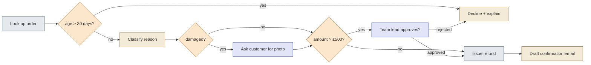
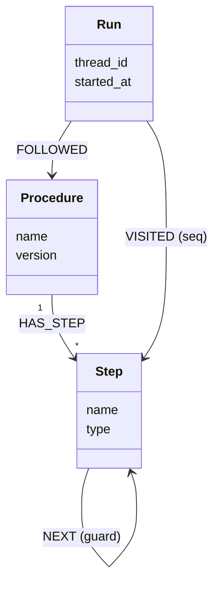

*[Knowledge Graphs: From Concept to Production](../README.md) · Day 17 of 23 · Arc 4 — Time, Procedure and Reason*

# Day 17 — Procedural Graphs: Put the Route in Code

> **Today's one idea:** A procedure is a state machine of typed steps — rule, tool, model, LLM, human — where the *route* between steps is decided by code, and the LLM only does judgment *inside* a step.
> **Reading time:** ~40 min · **Prereqs:** [Day 10](day-10-kgs-as-agent-memory.md), [Day 16](day-16-temporal-graphs.md)
> **Primary source for today:** Schluntz, Erik, and Barry Zhang. "Building effective agents." Anthropic Engineering, 19 December 2024. anthropic.com/engineering/building-effective-agents — sections "When (and when not) to use agents" and "Workflow: Routing".
> **Before you start:** Recall Day 16's load-bearing idea — one sentence, no looking. In terms of *which versions get written*, how does a correction differ from a real-world change?

---

## The hook (2–4 min)

A retailer gives its support agent the refund policy as a paragraph in the system prompt and a set of tools. Same customer, same broken lamp, same £640 order, three Tuesdays:

- **Week 1:** the agent asks for a photo, checks the amount, asks a team lead to approve, refunds. Perfect.
- **Week 2:** the customer sounds upset. The agent skips the photo "to reduce friction" and refunds £640 without approval. The policy says over £500 needs a team lead.
- **Week 3:** the agent asks for a photo, gets it, asks for it again, and loops until the customer gives up.

Nobody changed the prompt. The model just took a different route through the same paragraph. And when the auditor asks "*did we follow our refund process on order A-1?*", the only evidence is a chat log you'd have to re-read and interpret — the same problem as Day 16's deleted edge, one layer up.

This isn't a support-desk curiosity. A 2025 study of IT incident diagnosis found that constraining an LLM agent with the team's standard operating procedures raised root-cause accuracy from **35.5% (ReAct)** to **64.0%** (Flow-of-Action, WWW 2025). The procedure was already known. Letting the model rediscover it every time was the bug.

---

## Building the intuition (10–15 min)

### The driver and the signaller

On a railway, the driver is highly skilled: they handle speed, braking, weather, the unexpected cow. But the driver does not choose which track the train takes at a junction. The **points and signals** decide that, according to a timetable everyone agreed in advance. The driver's skill is used *between* junctions; the route is fixed *at* them.

Most agent failures in the hook are a driver choosing the track. A procedural graph separates the two jobs:

- **The signaller (code):** at each junction, a rule reads the current state and sets the next step. Always the same answer for the same state.
- **The driver (LLM):** inside a step, does the thing that needs judgment or language — classify a message, draft a reply, summarise a log.

### The refund policy as a graph

Here's the policy paragraph from the hook:

> *When a customer requests a refund, look up the order. If it's more than 30 days old, decline and explain the policy. Otherwise, work out the reason. If the item arrived damaged, ask for a photo. Refunds over £500 need a team lead's approval. Then issue the refund and confirm by email.*

Underline every **action** and every **if**. Each action becomes a step; each "if" becomes a junction whose branches are decided by a rule. Then label each step by *who or what* does it:



*Grey = tool, orange = rule (a junction), sand = LLM, blue = human.*

Now replay the three Tuesdays. Week 2's shortcut is impossible: there's no edge from "upset customer" to "issue refund" — the only way to the refund from a £640 damaged order goes through the photo and the team lead. Week 3's loop is impossible: "Ask for photo" has exactly one outgoing edge. And the auditor's question has a mechanical answer: list the steps the run visited.

Notice what the LLM still does: it reads "the lamp arrived in pieces" and decides that means `damaged`. That's real judgment — and it's the only thing it decides.

### Wait — didn't Day 10 say procedures aren't a KG job?

[Day 10's memory table](day-10-kgs-as-agent-memory.md) listed procedural memory ("how to do things") as "code / few-shot prompts — not a KG job." That was true for *skills* — how to call an API, how to format a SQL query. It's not true for *business procedures*: who must approve what, in which order, under which version of the policy. Those need to be queried ("which branch never fires?"), versioned (Day 16), and linked to the decisions they produced (Day 19). That's graph-shaped data. Today the procedure is *executed* by a workflow engine; by Exercise 3 its runs live in Neo4j.

---

## The formal picture (10–15 min)

### Definition

A **procedure graph** is a directed graph `P = (S, T)` over a shared, typed **state**:

- Each **step** `s ∈ S` has a **type** and declares which state fields it reads and writes.
- Each **transition** `t ∈ T` from a step is guarded by a **predicate** over the state. At every junction, the guards must be **complete** (some branch always applies) and **mutually exclusive** (only one applies) — so every state has exactly one next step.
- Only deterministic code evaluates guards. An LLM step can *write* a state field (`reason = "damaged"`) that a guard later reads, but it never names the next step.

### The five step types

| Type | Use it when… | In the refund graph | BPMN 2.0 name |
|---|---|---|---|
| **Rule** | The criterion is explicit and checkable | `age > 30`, `amount > £500` | Exclusive gateway / Business rule task (DMN) |
| **Tool** | A deterministic system call, read or write | Look up order, issue refund | Service task |
| **Model** | A trained model produces a score | *(a fraud score would go here)* | Service task |
| **LLM** | Language or judgment is needed and the output can be constrained | Classify reason, draft email | Service task |
| **Human** | Approval, liability, missing information, or low confidence | Customer photo, team-lead approval | User task |

The BPMN column matters because process teams already speak that language: an SOP written by an operations team often *is* a BPMN diagram, and the OMG BPMN 2.0.2 specification (also ISO/IEC 19510) defines exactly these elements.

### Same idea, six real systems

| System | Domain | What's in code | What the LLM does |
|---|---|---|---|
| **Rasa CALM Flows** | Customer support | YAML flows run by a deterministic flow policy with a dialogue stack | Turns user messages into commands like "start flow" or "set slot" |
| **Flow-of-Action** (Pei et al., WWW 2025) | IT ops / root-cause analysis | SRE diagnosis SOPs constrain the agent at key junctures | Investigates inside each SOP step |
| **HL7 CPG-on-FHIR** | Clinical guidelines | `PlanDefinition` resources with logic in CQL; `$apply` runs a plan against a patient | *(none required — the guideline is fully computable)* |
| **Camunda mortgage process** | Lending | BPMN process + DMN tables for country-risk and segment checks | AI agents called as service tasks; a judge agent's confidence decides auto-complete vs. human review |
| **Agentless** (Xia et al., 2024) | Coding agents | Fixed localize → repair → validate pipeline | Each phase's work; never chooses the next phase |
| **SOP-Agent** (Ye et al., 2025) | General / customer service | SOP compiled to a decision graph; at each node only that node's tools are available | Acts within the node it's in |

Read the right-hand column top to bottom: the LLM's job shrinks to *the part that needs language*. That's not a limitation — Anthropic's guidance is that workflows with "predefined code paths" beat autonomous agents whenever the steps are known in advance, on reliability, cost and debuggability.

### Building it in LangGraph

LangGraph builds agent workflows as state machines. Nodes are Python functions; `add_conditional_edges` attaches a routing function (the signaller); `interrupt()` pauses for a human and a **checkpointer** saves the state so the run resumes exactly where it stopped.

```python
# pip install langgraph
import operator
from typing import Annotated, Literal, TypedDict
from langgraph.graph import StateGraph, START, END
from langgraph.checkpoint.memory import InMemorySaver
from langgraph.types import interrupt, Command

ORDERS = {"A-1": {"age_days": 12, "amount": 640.0}, "A-2": {"age_days": 45, "amount": 80.0}}

class Refund(TypedDict, total=False):
    order_id: str
    message: str
    age_days: int
    amount: float
    reason: Literal["damaged", "wrong_item", "changed_mind"]
    approved: bool
    reply: str
    path: Annotated[list[str], operator.add]   # every step appends its name: the audit trail

def llm_classify(text: str) -> str:
    """Stand-in for an LLM call constrained to three labels (use structured output in real code)."""
    t = text.lower()
    return "damaged" if ("broken" in t or "damaged" in t or "pieces" in t) else \
           "wrong_item" if "wrong" in t else "changed_mind"

# --- steps (the driver's work) ---------------------------------------------------------
def lookup(s):          # TOOL
    o = ORDERS[s["order_id"]]
    return {"age_days": o["age_days"], "amount": o["amount"], "path": ["lookup"]}

def classify(s):        # LLM: writes a field, never picks the next step
    return {"reason": llm_classify(s["message"]), "path": ["classify"]}

def request_photo(s):   # HUMAN (customer)
    interrupt({"ask_customer": "Please upload a photo of the damage."})
    return {"path": ["request_photo"]}

def lead_approval(s):   # HUMAN (team lead)
    answer = interrupt({"ask_team_lead": f"Approve £{s['amount']:.0f} refund on {s['order_id']}?"})
    return {"approved": answer == "approve", "path": ["lead_approval"]}

def issue_refund(s):    # TOOL with a side effect: nothing before it can re-run it
    print(f"  >> refunded £{s['amount']:.2f} on {s['order_id']}")
    return {"path": ["issue_refund"]}

def confirm(s):         # LLM drafts the email
    return {"reply": f"Your £{s['amount']:.2f} refund is on its way.", "path": ["confirm"]}

def decline(s):         # LLM drafts the explanation
    why = "it's over 30 days since purchase" if s["age_days"] > 30 else "it wasn't approved"
    return {"reply": f"We can't refund this order because {why}.", "path": ["decline"]}

# --- routes (the signaller's work): pure functions of state ---------------------------
def amount_gate(s) -> str:
    return "lead_approval" if s["amount"] > 500 else "issue_refund"

def after_lookup(s) -> str:
    return "decline" if s["age_days"] > 30 else "classify"

def after_classify(s) -> str:
    return "request_photo" if s["reason"] == "damaged" else amount_gate(s)

def after_approval(s) -> str:
    return "issue_refund" if s["approved"] else "decline"

g = StateGraph(Refund)
for name, fn in [("lookup", lookup), ("classify", classify), ("request_photo", request_photo),
                 ("lead_approval", lead_approval), ("issue_refund", issue_refund),
                 ("confirm", confirm), ("decline", decline)]:
    g.add_node(name, fn)
g.add_edge(START, "lookup")
g.add_conditional_edges("lookup", after_lookup, ["decline", "classify"])
g.add_conditional_edges("classify", after_classify, ["request_photo", "lead_approval", "issue_refund"])
g.add_conditional_edges("request_photo", amount_gate, ["lead_approval", "issue_refund"])
g.add_conditional_edges("lead_approval", after_approval, ["issue_refund", "decline"])
g.add_edge("issue_refund", "confirm")
g.add_edge("confirm", END)
g.add_edge("decline", END)
app = g.compile(checkpointer=InMemorySaver())   # use a Postgres checkpointer in production

cfg = {"configurable": {"thread_id": "refund-A-1"}}
out = app.invoke({"order_id": "A-1", "message": "The lamp arrived in pieces", "path": []}, cfg)
print(out["__interrupt__"][0].value)            # {'ask_customer': ...}
out = app.invoke(Command(resume="photo.jpg"), cfg)
print(out["__interrupt__"][0].value)            # {'ask_team_lead': ...}
out = app.invoke(Command(resume="approve"), cfg)
print(out["path"])   # ['lookup', 'classify', 'request_photo', 'lead_approval', 'issue_refund', 'confirm']
```

Run it a thousand times with the same inputs and you get the same path a thousand times. Change only the message to "I changed my mind" and the path changes *for a reason you can point to*: `reason` became `changed_mind`, and `after_classify` read it.

---

## Where it breaks / what it is not (3–5 min)

**Not every task should be a graph.** If you can't write the steps down in advance — open-ended research, debugging an unfamiliar system — a fixed route will be wrong. Anthropic's advice is to use agents where "it's difficult or impossible to predict the required number of steps". Procedural graphs are for procedures you already have.

**An unconstrained LLM output breaks the signaller.** If `classify` returns `"broken"` instead of `"damaged"`, `after_classify` sends a damaged item down the no-photo branch without any error. Constrain LLM outputs that guards read to a fixed vocabulary (structured output or an enum), and treat anything else as its own branch — usually "ask a human".

**Guards must be complete and exclusive.** "Over £500" and "£500 or less" cover every amount once. "Under £500" and "over £500" leave £500.00 with no route. Most real SOPs have at least one of these gaps — that's tomorrow's drill.

**`interrupt()` re-runs the node on resume.** When the team lead answers, LangGraph restarts `lead_approval` from its first line. Anything with a side effect placed *before* the `interrupt()` — sending an email, charging a card — runs twice. Put side effects in their own node after the gate, as `issue_refund` is here.

**Breakpoints aren't approvals.** LangGraph's static `interrupt_before` is documented as a debugging tool. Human approval steps use `interrupt()` inside a node, with a durable checkpointer and a stable `thread_id`.

**The graph is not the SOP.** Written procedures leave steps implicit ("obviously you check the customer's identity first") and contain ambiguities the author never noticed. Converting one into a graph forces those decisions into the open — which is the point, and the hard part.

**Rigid isn't the same as brittle.** Real users go off-script ("actually, can I exchange it instead?"). Systems like Rasa CALM handle this with explicit *repair* flows that the graph can enter and leave — off-script behaviour is designed for, not improvised.

---

## Try it yourself (5–10 min)

### Exercise 1 — Retrieval (close the page first)

Without looking: (a) name the five step types and when to use each; (b) state who decides the route and what the LLM is allowed to write; (c) redraw the refund graph from the policy paragraph, marking each step's type.

<details>
<summary>Hint</summary>
Railway: who sets the points, who drives between them? For (c), start from the actions and the "if"s.
</details>

<details>
<summary>Solution</summary>

(a) **Rule** — explicit criterion; **Tool** — deterministic system call; **Model** — trained score; **LLM** — language or judgment with a constrained output; **Human** — approval, liability, missing information, low confidence.

(b) Deterministic routing functions decide the route, reading the state. The LLM may write state fields inside its step — ideally from a fixed vocabulary — but never names the next step.

(c) Lookup (tool) → age > 30? (rule) → decline (LLM) or classify (LLM) → damaged? (rule) → photo (human) → amount > £500? (rule) → team lead (human) → refund (tool) → confirm (LLM). Check you included the *rejected* edge from the team lead to decline — it's the one most people miss.
</details>

### Exercise 2 — Direct application: an IT runbook

Here's a real-shaped on-call runbook:

> *When a disk-usage alert fires, check current usage on the host. If it's below 85%, auto-resolve the alert. If it's between 85% and 95%, run the log-cleanup script and check again. If it's still above 85% after cleanup, or above 95% to begin with, page the on-call engineer, who decides whether to expand the volume. Expanding a production volume needs the service owner's approval. Record what happened in the incident ticket.*

(a) List the steps with their types. (b) Write the routing functions. (c) Wire it as a LangGraph `StateGraph` (stub the node bodies). (d) Find **two** places where the runbook is ambiguous and say how you resolved them.

<details>
<summary>Hint</summary>
"Between 85% and 95%" — which side owns exactly 85 and exactly 95? And "check again" — can the cleanup run twice? What happens if the engineer decides *not* to expand?
</details>

<details>
<summary>Solution</summary>

(a) `check_usage` (tool) · `auto_resolve` (tool) · `cleanup` (tool) · `recheck` (tool) · `page_oncall` (human: decides expand yes/no) · `owner_approval` (human, production only) · `expand_volume` (tool, side effect) · `write_ticket` (LLM summary). Junctions are rules.

(b)–(c):

```python
import operator
from typing import Annotated, TypedDict
from langgraph.graph import StateGraph, START, END

class Disk(TypedDict, total=False):
    host: str
    env: str                 # "prod" | "staging"
    usage: float
    cleaned: bool
    expand: bool
    owner_ok: bool
    path: Annotated[list[str], operator.add]

def first_check(s) -> str:   # usage in [0,85) / [85,95) / [95,100]
    if s["usage"] < 85: return "auto_resolve"
    if s["usage"] < 95: return "cleanup"
    return "page_oncall"

def after_recheck(s) -> str:
    return "auto_resolve" if s["usage"] < 85 else "page_oncall"

def after_oncall(s) -> str:
    if not s["expand"]: return "write_ticket"
    return "owner_approval" if s["env"] == "prod" else "expand_volume"

def after_owner(s) -> str:
    return "expand_volume" if s["owner_ok"] else "write_ticket"

def stub(name):
    return lambda s: {"path": [name]}   # replace with real tool / interrupt() / LLM bodies

g = StateGraph(Disk)
for n in ["check_usage", "auto_resolve", "cleanup", "recheck", "page_oncall",
          "owner_approval", "expand_volume", "write_ticket"]:
    g.add_node(n, stub(n))
g.add_edge(START, "check_usage")
g.add_conditional_edges("check_usage", first_check, ["auto_resolve", "cleanup", "page_oncall"])
g.add_edge("cleanup", "recheck")                          # cleanup runs once: no edge back to it
g.add_conditional_edges("recheck", after_recheck, ["auto_resolve", "page_oncall"])
g.add_conditional_edges("page_oncall", after_oncall, ["write_ticket", "owner_approval", "expand_volume"])
g.add_conditional_edges("owner_approval", after_owner, ["expand_volume", "write_ticket"])
for n in ["auto_resolve", "expand_volume"]:
    g.add_edge(n, "write_ticket")
g.add_edge("write_ticket", END)
app = g.compile()
```

(d) Ambiguities you should have found (any two):
- **Boundaries.** "Below 85" and "between 85 and 95" and "above 95" leave exactly 95% unassigned. The solution uses closed-open bands `[85, 95)` and `[95, 100]` — the same convention as Day 16's time windows — and writes it down.
- **Retry.** "Check again" could mean "loop until clean". The solution allows one cleanup, then escalates; a loop needs an explicit retry limit.
- **The "no" branch.** The runbook never says what happens if the engineer *declines* to expand, or the owner refuses. The solution sends both to `write_ticket`; your organisation may want an extra step (e.g., schedule a review).
- **Auto-resolve after cleanup** isn't ticketed in the original text. The solution tickets every outcome so the record is complete.

Each choice is a policy decision someone should sign off — the graph made it visible.
</details>

### Exercise 3 — Stretch: put the runs in the graph

You want to ask: *"In the last 90 days, which steps of the refund procedure never ran?"* — a branch that never fires is either dead policy or a bug in a guard. (a) Design a Neo4j schema that stores the procedure (steps and transitions) and each run's path. (b) Write the Cypher to load one run from `out["path"]`. (c) Write the "never ran" query.

<details>
<summary>Hint</summary>
Steps belong to a procedure; runs *follow* a procedure and *visit* steps in order. "Never ran" is a pattern that *doesn't* match — recall `OPTIONAL MATCH` and `WHERE … IS NULL` from [Day 5b](day-05b-drill-cypher.md).
</details>

<details>
<summary>Solution</summary>

(a) Schema:



(b) Load a run:

```cypher
MATCH (p:Procedure {name: 'refund', version: 1})
CREATE (r:Run {thread_id: $thread_id, started_at: datetime()})-[:FOLLOWED]->(p)
WITH r, p
UNWIND range(0, size($path) - 1) AS i
MATCH (p)-[:HAS_STEP]->(s:Step {name: $path[i]})
CREATE (r)-[:VISITED {seq: i}]->(s)
```

(c) Steps that never ran in 90 days:

```cypher
MATCH (p:Procedure {name: 'refund', version: 1})-[:HAS_STEP]->(s:Step)
OPTIONAL MATCH (r:Run)-[:VISITED]->(s)
  WHERE r.started_at > datetime() - duration('P90D') AND (r)-[:FOLLOWED]->(p)
WITH s, count(r) AS runs
WHERE runs = 0
RETURN s.name, s.type
```

If `decline` via the *rejected* edge never runs, either team leads approve everything (a policy finding) or `after_approval` is broken (a bug). Both are worth knowing. This `Run` node is the seed of Day 19's decision trace.
</details>

### Exercise 4 — Spaced callback: procedures change too (Day 16, Day 10)

On 1 April the approval threshold drops from £500 to £300. (a) Using Day 16's two clocks, how do you store both versions of the procedure? (b) A refund run *starts* on 31 March and is still waiting for the team lead on 2 April. Which threshold applies — and where must that choice be recorded? (c) Day 10 put procedural memory in "code / few-shot prompts". Give one question about procedures that a prompt can't answer but the graph from Exercise 3 can.

<details>
<summary>Hint</summary>
A procedure version is a fact with a valid window. For (b), there are two defensible answers — the mistake is not choosing.
</details>

<details>
<summary>Solution</summary>

(a) Two `Procedure` nodes (`version: 1`, `version: 2`) with valid windows `[…, 1 Apr)` and `[1 Apr, …)` and record-time stamps for when each was published. If someone later finds the published threshold was mistyped, that's a *correction* — retire and rewrite, exactly as on Day 16.

(b) Either "rules in force when the run started" (the run is pinned to v1 at `START` — common for applications, like a loan judged on the rules at application date) or "rules in force when the decision is made" (v2 at approval time). Both are defensible; the error is leaving it to chance. Record it: `(:Run)-[:FOLLOWED {version: 1, pinned_at: …}]->(:Procedure)`, so an auditor can see which rules the run was held to.

(c) For example: "Which steps of v1 never ran?", "How many runs took the rejected branch after the threshold changed?", "Which runs were still in flight when v2 took effect?" A prompt holds *how* to do it; only queryable, versioned data can tell you what was *actually done*.
</details>

**Transfer — apply it:**

> Name a situation from your own domain or current work where today's concept applies. Write one concrete sentence: what the input is, what today's idea does to it, and what the output is. If nothing comes to mind in 60 seconds, that is the signal — re-read the hook and try again.
>
> *Example shape:* "When a claim arrives, the input is the first notice of loss; a procedure graph routes it by coverage rule and fraud score — fast-track under 30, adjuster 30–70, SIU above 70 — with the LLM only drafting the cited report, and the output is a claim decision plus the exact branch it took."

---

## Connect it back

[Day 16](day-16-temporal-graphs.md) gave every fact a history; today gave every *action* a route. The two meet in Exercise 4: a procedure is itself a versioned fact, and every run has to say which version it followed. The LLM hasn't become less useful — it now spends its skill on classification and language, where it's good, instead of on remembering your approval thresholds, where it isn't.

Tomorrow is a drill: you'll take messy, real-shaped SOPs from four domains and turn them into procedure graphs — finding the missing branches, overlapping thresholds and hidden human gates that every written procedure contains.

**The question you can answer now that you couldn't yesterday:** an agent handled the same request two different ways — what would you change so that the difference is either impossible, or recorded along with its reason?

---

## Suggested readings for today

**Required if you have 15 extra minutes:** Schluntz & Zhang, "Building effective agents," Anthropic, 2024 — re-read **"When (and when not) to use agents"**, then **"Workflow: Routing"** and **"Workflow: Evaluator-optimizer"**. Today's refund graph is routing; Exercise 2's cleanup-then-recheck is a tiny evaluator loop. Notice how little of the article is about models and how much is about structure.

**If you want the deep version:**
- Ye, Anbang, Qianran Ma, Jia Chen, et al. "SOP-Agent: Empower General Purpose AI Agent with Domain-Specific SOPs." arXiv:2501.09316, 2025 — read the method section on representing SOPs as decision graphs and restricting each step's tools. It's the closest research match to today's design, with a customer-service benchmark.
- LangGraph documentation, "Interrupts" — docs.langchain.com/oss/python/langgraph/interrupts. Read the rules for side effects before `interrupt()` and for multiple interrupts in one node; they're the source of two of today's "where it breaks" points.
- Pei, Changhua, Zexin Wang, Fengrui Liu, et al. "Flow-of-Action: SOP Enhanced LLM-Based Multi-Agent System for Root Cause Analysis." WWW 2025 (Industry Track). arXiv:2502.08224 — the 35.5% → 64.0% result from the hook. Worth reading for how SOPs constrain an agent "at crucial junctures" without scripting every move.

---

← [Day 16 — Temporal Graphs](day-16-temporal-graphs.md) &nbsp;|&nbsp; [Day 18 — Drill: SOP → Procedure Graph →](day-18-drill-sop-to-procedure-graph.md)
