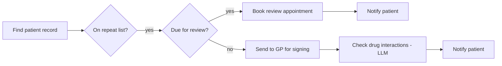
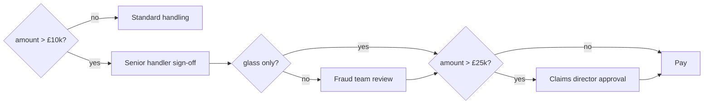

*[Knowledge Graphs: From Concept to Production](../README.md) · Day 18 of 23 · Arc 4 — Time, Procedure and Reason*

# Day 18 — Drill: SOP → Procedure Graph

> **Today's one idea:** Seven graded exercises on the arc's first bottleneck — turning a written procedure into a typed, complete, versioned procedure graph. No new concepts, no narrative.
> **Reading time:** ~45 min (exercises only — this is the gym, not the library) · **Prereqs:** [Day 16](day-16-temporal-graphs.md), [Day 17](day-17-procedural-graphs.md)
> **Primary source for today:** Garg, Deepeka, Sihan Zeng, Sumitra Ganesh, and Leo Ardon. "Generating Structured Plan Representation of Procedures with LLMs." arXiv:2504.00029, 2025 — the SOPStruct pipeline (segment → subtask nodes → verify) and its five node categories.
> **Before you start:** Recall Day 17's load-bearing idea — one sentence, no looking. Who decides the route in a procedure graph, and what is the LLM allowed to write?

---

**The conversion procedure you're drilling** (from SOPStruct and Day 17 — keep it next to you, it's the only support you get):

1. **Segment** the SOP; list every action as a candidate step with its *inputs* and *outputs*.
2. **Mark every decision word** — *if, unless, when, otherwise, except, more than, between* — as a junction.
3. **Make each junction's guards complete and exclusive**; write the boundary convention down.
4. **Type each step:** rule · tool · model · LLM · human.
5. **Place human gates** as `interrupt()` steps; keep side effects in their own steps after the gate.
6. **Version it** (Day 16) and **check it against reality** (replay past runs).

Work each exercise on paper or in an editor *before* opening the hint. If you get one wrong, redo it cold tomorrow — don't re-read the solution.

---

## Exercise 1 — Segment and type (banking: KYC onboarding)

> *New business customers must be verified before an account is opened. Collect the company registration number and the names of all directors. Check the company against the companies registry. Screen every director against the sanctions list. If any director is a match, stop and refer to Compliance. If the company is registered outside the UK, request certified copies of its incorporation documents. Once checks pass, open the account and send the welcome pack.*

Produce a table: step · type · inputs · outputs. Then list the procedure's **initial inputs** (consumed but produced by no step) and **final outputs** (produced but consumed by no step).

<details>
<summary>Hint</summary>
"Screen <em>every</em> director" is not one step. And "is a match" sounds like a yes/no — what does a sanctions screening tool actually return?
</details>

<details>
<summary>Solution</summary>

| Step | Type | Inputs | Outputs |
|---|---|---|---|
| Collect details | Human (customer) | — | `reg_no`, `directors[]` |
| Registry check | Tool | `reg_no` | `company_status`, `jurisdiction` |
| Screen director *(once per director)* | Tool | `director` | `hits[]` with match scores |
| Review potential match | Human (Compliance) | `hits[]` | `confirmed_match: bool` |
| Request incorporation docs | Human (customer) | `jurisdiction` | `docs` |
| Open account | Tool (side effect) | all checks passed | `account_id` |
| Send welcome pack | Tool / LLM draft | `account_id` | `welcome_sent` |

**Initial inputs:** the customer request itself (`reg_no` and `directors[]` arrive from the customer). **Final outputs:** `account_id`, `welcome_sent`, or a Compliance referral.

Two things the SOP hides:
- **"Every" is a loop.** Screening is one step *mapped over* the directors list (in LangGraph, a fan-out with `Send`, or a loop inside a tool step). If you wrote "screen directors" once, you'd miss the case where director 3 of 5 is the match.
- **"Is a match" hides a threshold.** Screening tools return *potential* matches with scores. The real procedure is: score ≥ threshold → human review → confirmed or cleared. That human step is not in the SOP, and it's where most of the work happens. Raise it with the SOP owner — don't invent the threshold yourself.

Also missing: what happens if the registry check fails (company dissolved or not found)? There's no branch. Every tool step needs a failure route.
</details>

---

## Exercise 2 — Make the guards complete and exclusive (lending: credit-limit increase)

> *Requests under £1,000 are approved automatically if the customer has no missed payments. Requests from £1,000 to £5,000 go to an underwriter. Requests over £5,000, or from customers with a missed payment in the last 12 months, are declined.*

(a) Find one request that has **no route** and one that has **two**. (b) Rewrite the guards as one Python routing function that is complete and exclusive, stating every decision you had to make.

<details>
<summary>Hint</summary>
"No missed payments" and "no missed payment in the last 12 months" are different conditions. Try a customer who missed a payment two years ago.
</details>

<details>
<summary>Solution</summary>

(a) **No route:** £500 request, one missed payment 2 years ago. Not auto-approved (they have *a* missed payment), not declined (not in the last 12 months), not underwriter (under £1,000). **Two routes:** £3,000 request, missed payment 6 months ago — "underwriter" and "declined" both apply.

(b) Order the guards so the strongest condition wins, and make each band closed-open:

```python
def credit_limit_route(amount: float, missed_last_12m: bool, missed_ever: bool) -> str:
    if missed_last_12m or amount > 5_000:
        return "decline"                 # decision 1: decline conditions take priority
    if amount >= 1_000:
        return "underwriter"             # [1000, 5000]
    if not missed_ever:
        return "auto_approve"            # [0, 1000) and a clean history
    return "underwriter"                 # decision 2: old missed payment, small request -> a human looks
```

Decisions you had to make (and should get signed off): decline beats underwriter when both apply; a missed payment older than 12 months sends small requests to an underwriter rather than declining or approving them; £5,000 exactly goes to the underwriter ("from £1,000 to £5,000" is inclusive). A truth table over `(band, missed_last_12m, missed_ever)` — 3 × 2 × 2 = 12 rows, minus the impossible ones — is the fastest way to prove you've covered everything.
</details>

---

## Exercise 3 — Spot what was invented, dropped and hidden (pharmacy: repeat prescriptions)

The SOP:

> *When a repeat prescription request comes in, find the patient's record. If the medication is on their repeat list and not due for review, send it to the GP for signing. If it's due for review, book a review appointment and tell the patient. Controlled drugs always go to the GP with a note.*

An LLM converted it into this graph:



Find: one step the LLM **invented**, one rule it **dropped**, one **missing branch**, and one **implicit step** the SOP never states. For each, say what you'd do about it.

<details>
<summary>Hint</summary>
Compare sentence by sentence. Then ask: before you find "the patient's record", how do you know who's asking?
</details>

<details>
<summary>Solution</summary>

- **Invented:** "Check drug interactions (LLM)". Not in the SOP — and handing a clinical safety check to an unvalidated LLM step is worse than leaving it out. Remove it; if the SOP owner wants it, it becomes a defined step with a validated tool behind it.
- **Dropped:** "Controlled drugs always go to the GP with a note." This rule overrides the others ("always"), so it should be the *first* junction after finding the record, not tacked on later.
- **Missing branch:** "On repeat list? → no" goes nowhere. A medication not on the repeat list needs a route (probably: refer to GP as a new request).
- **Implicit step:** confirming the requester is the patient or an authorised representative before opening a record. Every pharmacist does it; the SOP doesn't say it.

What to do: **remove** what was invented, **restore** what was dropped, and send the missing branch and the implicit step back to the SOP owner as *questions*. Silently adding them yourself is the same error the LLM made — you'd be inventing policy. SOPStruct reports exactly these three failure modes (added steps, dropped steps, lost entities) in LLM baselines, and uses a planner check for soundness plus an LLM check for completeness to catch them.
</details>

---

## Exercise 4 — Fix the human gate (finance: expense approval)

This node passed code review. It's broken in four ways. Find them and rewrite it.

```python
def manager_approval(state):
    send_email(state["manager"], f"Please approve expense {state['claim_id']}")
    try:
        answer = interrupt({"approve?": state["claim_id"]})
    except Exception:
        answer = "approve"
    if answer not in ("approve", "reject"):
        answer = interrupt({"approve?": "please answer approve or reject"})
    return {"approved": answer == "approve"}

app = graph.compile()
```

<details>
<summary>Hint</summary>
What happens to the lines <em>above</em> <code>interrupt()</code> when the manager answers and the node resumes? And what exactly does <code>interrupt()</code> do to pause the graph?
</details>

<details>
<summary>Solution</summary>

1. **The email is sent twice.** On resume, LangGraph re-runs the node from its first line, so `send_email` fires again. Side effects never go before an `interrupt()`.
2. **The `except` auto-approves every expense.** `interrupt()` pauses the graph by raising a special exception. The bare `except Exception` catches it, so the graph never pauses and `answer` becomes `"approve"`. LangGraph's docs warn specifically against wrapping `interrupt()` in a bare try/except.
3. **The re-prompt is fragile.** A second `interrupt()` in the same node works by position, so the answers must arrive in the same order on every replay. A conditional edge back to the node is simpler and shows up in the graph.
4. **No checkpointer.** Without one, there's nowhere to save the paused state, so the run can't be resumed.

```python
def notify_manager(state):                       # side effect in its own step
    send_email(state["manager"], f"Please approve expense {state['claim_id']}",
               idempotency_key=f"approval-{state['claim_id']}")
    return {}

def manager_approval(state):                     # the gate does nothing but ask
    return {"answer": interrupt({"approve?": state["claim_id"]})}

def after_approval(state) -> str:                # the signaller validates the answer
    if state["answer"] == "approve": return "pay"
    if state["answer"] == "reject":  return "notify_claimant"
    return "manager_approval"                    # invalid answer: ask again, visibly

graph.add_edge("notify_manager", "manager_approval")
graph.add_conditional_edges("manager_approval", after_approval,
                            ["pay", "notify_claimant", "manager_approval"])
app = graph.compile(checkpointer=checkpointer)  # durable (e.g. Postgres) in production
```
</details>

---

## Exercise 5 — Rule, model, LLM or human? (eight sentences, six industries)

For each sentence: give the step type. For any LLM step, give its **constrained output vocabulary** and the **fallback branch** for output outside it.

1. *(Accounts payable)* "If the invoice total differs from the purchase-order total by more than 2%, hold the payment."
2. *(Retail banking)* "If the customer seems vulnerable — for example bereaved or seriously ill — transfer them to the specialist team."
3. *(Payments)* "If the transaction looks fraudulent, block the card."
4. *(Construction)* "The site manager signs off the permit to work."
5. *(Legal ops)* "If the contract contains a non-standard indemnity clause, send it to Legal."
6. *(Clinic triage)* "If the patient's temperature is above 38°C, see them within the hour."
7. *(Customer service)* "Use your judgement to decide whether to escalate."
8. *(Logistics)* "If a Gold-tier customer's shipment is more than two days late, apologise and offer a voucher."

<details>
<summary>Hint</summary>
"Looks fraudulent" and "seems vulnerable" both sound like judgment — but one of them is usually a trained model with a score. And one sentence can't be converted at all as written.
</details>

<details>
<summary>Solution</summary>

| # | Type | Notes |
|---|---|---|
| 1 | **Rule** | `abs(inv - po) / po > 0.02`. Pure arithmetic; never an LLM. |
| 2 | **LLM** → rule | Output `{vulnerable, not_vulnerable, unsure}`; `unsure` → human. A missed vulnerable customer costs far more than a false alarm, so bias the prompt and threshold towards flagging. |
| 3 | **Model** → rule → human band | A fraud score with two thresholds: above the high one, block automatically; between them, send to a human. |
| 4 | **Human** | A liability signature. Automating it would defeat its purpose. |
| 5 | **LLM** → human | Extraction and classification `{standard, non_standard, unclear}`; both `non_standard` and `unclear` → Legal. |
| 6 | **Rule** on a **tool/human** input | The threshold is a rule; the reading comes from a device or a nurse. Watch the boundary: is 38.0°C "above 38"? |
| 7 | **Not convertible** | "Use your judgement" is not a specification. Go back to the owner and ask *what the judgement depends on*. Until then it's a human step — but writing it as a human step hides the gap rather than fixing it. |
| 8 | **Rule** (two fields) → **LLM** drafts | `tier == "gold" and days_late > 2` is the rule; the apology is language. The voucher amount is a rule too — don't let the LLM pick it. |
</details>

---

## Exercise 6 — Version a change (insurance: motor claims) — *Day 16 callback*

Procedure **v1** (in force since 1 Jan 2026): *"Claims over £10,000 need a senior handler's sign-off."*

The change memo: *"From 1 June 2026, claims over £10,000 also need a second review from the fraud team, except glass-only claims. Claims over £25,000 additionally need the claims director's approval."*

(a) Draw the approval part of **v2**. (b) List every step and edge that changed. (c) Write the Neo4j writes that store v2 and end v1's validity, following Day 16's rule — and say whether this is a correction or a real-world change. (d) Find the ambiguity in the memo.

<details>
<summary>Hint</summary>
Day 16: is the old procedure wrong, or was it right until 1 June? That decides which versions you write. For (d): read "except glass-only claims" and "additionally" together.
</details>

<details>
<summary>Solution</summary>

(a)



(b) New steps: fraud team review (human), claims director approval (human). New junctions: glass only?, amount > £25k? New edges: everything after the senior sign-off.

(c) This is a **real-world change**: v1 was correct until 1 June. So v1 survives with its valid window closed, and v2 opens on 1 June:

```cypher
// retire the belief "v1 is valid with no end"...
MATCH (v1:Procedure {name: 'motor_claim_approval', version: 1})
WHERE v1.expired_at IS NULL
SET v1.expired_at = datetime($now)
// ...and rewrite it with a closed window, plus the new version
WITH v1
CREATE (:Procedure {name: v1.name, version: 1, valid_from: v1.valid_from,
                    valid_to: datetime('2026-06-01T00:00:00Z'), recorded_at: datetime($now)})
CREATE (:Procedure {name: v1.name, version: 2,
                    valid_from: datetime('2026-06-01T00:00:00Z'), recorded_at: datetime($now)})
```

(Steps and edges are then attached to the v2 node. In practice you'd model "procedure version" as its own node so step definitions aren't duplicated — the point here is the two clocks.) Just setting `valid_to` on v1 in place would rewrite what you believed before the memo.

(d) **Does the glass-only exception also skip the director?** "Except glass-only claims" might cover the whole memo or only the fraud review. A £30,000 glass-only claim (rare, but think of a coach windscreen fleet claim) gets different routes under each reading. The diagram above assumes the exception covers only the fraud review — that's a question for the memo's author, recorded with their answer. Also unstated: do claims *already in flight* on 1 June follow v1 or v2? (Day 17, Exercise 4.)
</details>

---

## Exercise 7 — Replay reality against the graph (IT operations: conformance checking)

Here's Day 17's disk-alert runbook as a transition table, and five runs from last month's incident log:

```python
EDGES = {
    "START": {"check_usage"},
    "check_usage": {"auto_resolve", "cleanup", "page_oncall"},
    "cleanup": {"recheck"},
    "recheck": {"auto_resolve", "page_oncall"},
    "page_oncall": {"write_ticket", "owner_approval", "expand_volume"},
    "owner_approval": {"expand_volume", "write_ticket"},
    "auto_resolve": {"write_ticket"},
    "expand_volume": {"write_ticket"},
    "write_ticket": {"END"},
}
RUNS = [
    ("r1", "prod",    ["check_usage", "cleanup", "recheck", "auto_resolve", "write_ticket"]),
    ("r2", "prod",    ["check_usage", "page_oncall", "expand_volume", "write_ticket"]),
    ("r3", "staging", ["check_usage", "cleanup", "cleanup", "recheck", "page_oncall", "write_ticket"]),
    ("r4", "prod",    ["check_usage", "auto_resolve"]),
    ("r5", "prod",    ["check_usage", "page_oncall", "owner_approval", "expand_volume", "write_ticket"]),
]
```

(a) Write `check(path, env) -> str` that returns `"conforms"` or the first violation. (b) Which runs deviate, and how? (c) One deviation passes a pure edge check. Why, and what does that tell you about conformance checking? (d) For each deviation, is the graph wrong or the people?

<details>
<summary>Hint</summary>
Edges tell you which moves exist. Guards tell you which moves were <em>allowed in that state</em>. Which run used an edge that exists, in a state where its guard was false?
</details>

<details>
<summary>Solution</summary>

(a)

```python
def check(path: list[str], env: str) -> str:
    steps = ["START", *path, "END"]
    for a, b in zip(steps, steps[1:]):
        if b not in EDGES.get(a, set()):
            return f"illegal move {a} -> {b}"
        if (a, b) == ("page_oncall", "expand_volume") and env == "prod":
            return "guard violated: prod expansion without owner approval"
    return "conforms"

for run_id, env, path in RUNS:
    print(run_id, check(path, env))
# r1 conforms
# r2 guard violated: prod expansion without owner approval
# r3 illegal move cleanup -> cleanup
# r4 illegal move auto_resolve -> END
# r5 conforms
```

(b) **r2** expanded a production volume without the owner's approval. **r3** ran cleanup twice. **r4** auto-resolved without writing a ticket.

(c) **r2's move exists** — `page_oncall → expand_volume` is a real edge (it's how staging works). Only the *guard* (`env != "prod"`) forbids it. A checker that looks only at edges says r2 is fine. Conformance has two levels: **structural** (is this move in the graph?) and **guard** (was it allowed in this state?). The second needs the run's state — so runs must record their state, not just their path. That's tomorrow's lesson.

(d) This is the point of conformance checking (van der Aalst): a deviation means *either* the model or reality is wrong, and you have to find out which.
- **r2: probably the people.** It's a control failure that needs follow-up.
- **r3: possibly the graph.** If engineers routinely run cleanup twice because the first pass often isn't enough, the runbook should allow a bounded retry. Ask them.
- **r4: probably the tooling.** Auto-resolve was likely implemented without the ticket step. Fix the code, then re-run the check over all of last month's runs.
</details>

---

**Transfer — apply it:**

> Name a situation from your own domain or current work where today's concept applies. Write one concrete sentence: what the input is, what today's idea does to it, and what the output is. If nothing comes to mind in 60 seconds, that is the signal — re-read the hook and try again.
>
> *Example shape:* "Our SIU referral guideline is a two-page Word document; segmenting it and typing every step would turn its three 'use discretion' sentences into explicit questions for the SIU lead, and the output is a versioned procedure graph plus a list of decisions nobody had actually written down."

---

## Suggested readings for today

**Required if you have 15 extra minutes:** Garg et al., "Generating Structured Plan Representation of Procedures with LLMs" (the SOPStruct paper), arXiv:2504.00029, 2025 — read the method: how the SOP is segmented at context shifts, how each segment becomes subtask nodes (name, inputs, outputs, dependencies, category), and how a PDDL planner checks the graph is *sound* while an LLM checks it's *complete*. Compare their five node categories (Human Input, Information Processing, Information Extraction, Knowledge, Decision) with Day 17's five step types: they slice the same work differently.

**If you want the deep version:**
- van der Aalst, Wil M. P. *Process Mining: Data Science in Action.* 2nd ed., Springer, 2016. DOI 10.1007/978-3-662-49851-4 — the **conformance checking** chapter (token replay and alignments). `[VERIFY chapter number]` Exercise 7 is a toy version; this is the real theory, including how to measure *how far* a run deviates, not just whether it does.
- Nandi, Subhrangshu, Arghya Datta, Rohith Nama, et al. "SOP-Bench: Complex Industrial SOPs for Evaluating LLM Agents." arXiv:2506.08119, 2025 — **v1** (June 2025): over 1,800 tasks across 10 industrial domains, where function-calling agents averaged 27% success and ReAct agents 48%. The current **v2** (February 2026, under review) grows to 2,000+ tasks across 12 domains and reports newer models; check which version you're quoting. Use it as evidence when someone says "just put the SOP in the prompt".
- OMG, *Business Process Model and Notation (BPMN) 2.0.2*, formal/13-12-09, 2014 (also ISO/IEC 19510) — omg.org/spec/BPMN — the sections on **gateways** (exclusive, parallel, inclusive) and **user tasks**. If your organisation already has BPMN diagrams, they're half-converted procedure graphs. `[VERIFY section numbers]`

---

← [Day 17 — Procedural Graphs](day-17-procedural-graphs.md) &nbsp;|&nbsp; [Day 19 — Context Graphs →](day-19-context-graphs.md)
