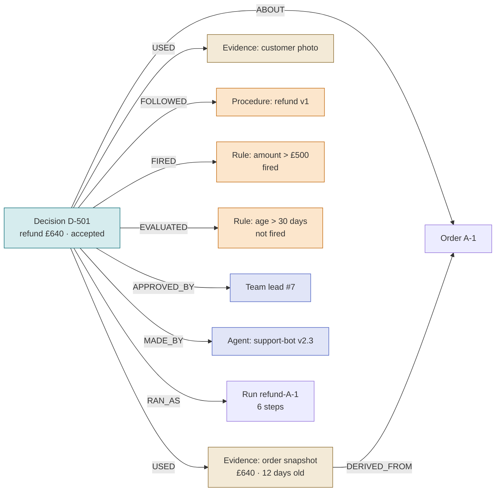

*[Knowledge Graphs: From Concept to Production](../README.md) · Day 19 of 23 · Arc 4 — Time, Procedure and Reason*

# Day 19 — Context Graphs: Record the Why

> **Today's one idea:** A decision trace links each decision to the evidence *as it stood then*, the procedure and policy version in force, the rules that fired, the steps that ran and who signed off — and a decision that turns out wrong is superseded, never edited.
> **Reading time:** ~40 min · **Prereqs:** [Day 13](day-13-schema-design-patterns.md), [Day 16](day-16-temporal-graphs.md), [Day 17](day-17-procedural-graphs.md)
> **Primary source for today:** W3C. *PROV-O: The PROV Ontology.* W3C Recommendation, 30 April 2013. w3.org/TR/prov-o/ — the "Starting Point" terms (Entity, Activity, Agent; `used`, `wasGeneratedBy`, `wasAssociatedWith`, `actedOnBehalfOf`, `wasDerivedFrom`) and the qualified association with `hadPlan`. `[VERIFY section numbers]`
> **Before you start:** Recall Day 18's Exercise 7 — no looking. Run r2 passed a pure edge check but broke the procedure. Why — and what did the checker need that a list of visited steps doesn't contain?

---

## The hook (2–4 min)

A software company renews a customer at a **20% discount**. Its pricing policy caps renewal discounts at 10%. The account manager escalated, the VP of Sales approved an exception because the customer had suffered a three-day outage that quarter, and Finance signed off.

The CRM records one fact: `discount: 20%`.

Six months later, three people look at that field:

- A new account manager sees 20% and offers it to a similar customer who had no outage.
- An auditor asks why a deal broke the pricing policy, and nobody remembers.
- An AI agent asked to "handle renewals like we usually do" learns that 20% is normal.

This is the worked example at the centre of Foundation Capital's 2025 essay on **context graphs**: systems of record capture *what* happened but not *why*, so the reasoning that connected data to action is never stored as data at all. Everything that would have made the 20% safe to reuse — the exception path, the reason, the approvers, the policy it broke — lived in a Slack thread.

Lending regulators got there first. In the US, a lender that denies credit must tell the applicant the *specific principal reasons* — and the CFPB's Circular 2022-03 says that obligation doesn't go away because the model is complex. "Score: 612" is an outcome. It is not an explanation.

---

## Building the intuition (10–15 min)

### The scoreboard and the court judgment

A scoreboard tells you the result: *Smith 3 – Jones 1.* It's perfect for "who won?" and useless for "why?" or "would the same thing happen again?"

A court judgment is different. It has a standard shape that hasn't changed much in centuries:

- **The facts found** — as the court understood them on the day.
- **The law applied** — which statute, *in which version*.
- **The reasoning** — which tests were met, which weren't.
- **Precedents cited** — earlier judgments this one follows or distinguishes.
- **Who decided, and when.**
- **What happened next** — and if it's later overturned, the original stays on the record, marked as overturned.

That shape is why one judgment can guide thousands of later cases. A context graph gives an organisation's decisions the same shape. Not because every refund is a court case, but because "how did we decide last time, and does it apply here?" is the same question in both.

### Day 17's refund, as a judgment

Day 17's LangGraph run for order A-1 ended with `path = [lookup, classify, request_photo, lead_approval, issue_refund, confirm]`. That's the scoreboard plus the route. Here's the judgment:



Now the three questions from the hook have answers you can query:

- **Why?** The amount rule fired, so a team lead approved, under refund procedure v1, based on a photo.
- **Safe to reuse?** Only for damaged items with a photo, under v1's threshold. A new case that matches on amount but not on evidence isn't the same.
- **Who's accountable?** Team lead #7 for the approval, support-bot v2.3 for the classification.

Notice what's **not** in the picture: the model's internal chain of thought. The trace records what the application *did and used*, not what the model "was thinking". More on that below.

### Two things make it trustworthy

**1. Evidence as it stood then.** If the trace just points at Order A-1, and next week someone corrects the order amount to £460, the trace now silently says "we refunded £460 and the rule fired" — which is nonsense. Either snapshot the evidence (with a hash), or — if your graph is bitemporal — store the decision's `recorded_at` so you can read the evidence with Day 16's `known_at`. Day 16 is what makes a pointer safe.

**2. Supersede, never edit.** If a chargeback later shows A-1 was fraud, you don't change D-501 to "rejected". You write D-502, *"reverse refund — fraud confirmed"*, linked `SUPERSEDES → D-501`, and mark D-501 `superseded`. Software engineers have done this for a decade with **Architecture Decision Records**: a reversed decision isn't edited; it's marked superseded and linked to the record that replaced it.

---

## The formal picture (10–15 min)

### A decision trace, defined

A **decision trace** is a subgraph centred on one decision node. Its vocabulary comes from **W3C PROV**, the standard model of provenance, which has three core types:

- **Entity** — a thing: an order snapshot, a photo, a policy document, the refund itself.
- **Activity** — something that happened over time: the decision, each step of the run.
- **Agent** — something responsible: the LLM agent (with a version), the team lead, the organisation they act for.

…and a handful of relations: an activity **`used`** entities, an entity **`wasGeneratedBy`** an activity, an activity **`wasAssociatedWith`** an agent, an agent **`actedOnBehalfOf`** another, an entity **`wasDerivedFrom`** another. PROV's *qualified* association adds **`hadPlan`** — the plan the agent followed. That's where the procedure version goes.

### The must-have fields

| Field | Why it's needed | PROV term | HL7 FHIR Provenance (health) |
|---|---|---|---|
| **Identity, type, status** (`proposed`, `accepted`, `superseded`) | So it can be referenced and superseded | Activity | `Provenance.id` |
| **About** — the specific version of each entity | So it's clear *what* was decided | `used` / generated entity | `target` (version-specific) |
| **Evidence snapshot**, each with a role | So the trace can't change underneath you | `used` + `wasDerivedFrom` | `entity` with `role`: source, derivation, quotation, revision… |
| **Procedure and policy version** | So the decision can be replayed under the rules in force | `hadPlan` | `policy` |
| **Rules evaluated and fired**, with the specific reasons | So it can be explained (and, in lending, so you meet the law) | attributes on the Activity | `reason` |
| **Exceptions and overrides** — and who approved them | The 20% discount's whole story | qualified association | `agent` with `role` |
| **Process** — run, steps, tool calls with arguments and results | So you can see *how*, not just *what* | Activities linked to the decision | `activity` |
| **Who** — agent ID and version, model, human approvers, on whose behalf | Accountability | `wasAssociatedWith`, `actedOnBehalfOf` | `agent.who`, `agent.onBehalfOf`, `signature` |
| **Two times** — when it happened, when it was recorded | Day 16, applied to decisions | `startedAtTime` / recorded | `occurred` / `recorded` |
| **Precedent cited** and **effects** | So decisions form a chain you can follow | `wasInformedBy` / generated entities | — |

FHIR Provenance is worth pausing on: it's a deployed healthcare standard built directly on PROV, and it already separates `occurred` from `recorded` — Day 16's two clocks, in a hospital record.

### Same idea, six real systems

| System | Domain | Shape of the trace | Lesson |
|---|---|---|---|
| **`neo4j-agent-memory`** (Neo4j Labs) | Agent memory | `ReasoningTrace` → `ReasoningStep` → `ToolCall` (`INSTANCE_OF` a `Tool`); steps `TOUCHED` the entities they used | Traces live in the *same* graph as the facts they touch |
| **HL7 FHIR Provenance** | Healthcare | `target`, `occurred`, `recorded`, `policy`, `reason`, `agent`, `entity.role`, `signature` | A standard can make traces interoperable |
| **Architecture Decision Records** (Nygard, 2011) | Software | Title · Context · Decision · Status · Consequences | Supersede, never edit |
| **CFPB Circular 2022-03** | Lending | Specific principal reasons for adverse action | Regulators require the "why", not the score |
| **OpenLineage** | Data / ML pipelines | Job · Run (stable `runId`) · Dataset; per-run input facets | Record *which* version of the input a run read |
| **OpenTelemetry GenAI agent spans** | Observability | `invoke_agent`, `execute_tool` spans; message content is opt-in | Map traces onto spans, but don't log sensitive content by default |

### Writing a trace in Neo4j

This takes the final state of Day 17's refund run and writes the decision. It stores the order as a snapshot with a hash, so the evidence can't drift.

```python
# pip install neo4j
import hashlib, json
from datetime import datetime, timezone
from neo4j import GraphDatabase

URI, AUTH = "bolt://localhost:7687", ("neo4j", "password")

def snapshot(obj: dict) -> tuple[str, str]:
    """Freeze evidence: canonical JSON plus its SHA-256, so later edits can't change the trace."""
    text = json.dumps(obj, sort_keys=True)
    return text, hashlib.sha256(text.encode()).hexdigest()

DECISION = """
MATCH (o:Order {id: $order_id})
MATCH (p:Procedure {name: 'refund', version: $proc_version})
CREATE (d:Decision {id: $decision_id, type: 'refund', outcome: $outcome, status: 'accepted',
                    occurred_at: $occurred_at, recorded_at: datetime()})
CREATE (d)-[:ABOUT]->(o)
CREATE (d)-[:FOLLOWED]->(p)
CREATE (e:Evidence {kind: 'order_snapshot', snapshot: $order_json, sha256: $order_hash})
CREATE (e)-[:DERIVED_FROM]->(o)
CREATE (d)-[:USED {role: 'source'}]->(e)
MERGE (a:Agent {id: $agent_id}) CREATE (d)-[:MADE_BY]->(a)
MERGE (h:Person {id: $approver})  CREATE (d)-[:APPROVED_BY]->(h)
"""

RULES = """
MATCH (d:Decision {id: $decision_id})
UNWIND $rules AS rule
MERGE (r:Rule {id: rule.id, version: rule.version})
CREATE (d)-[:EVALUATED {fired: rule.fired, inputs: rule.inputs}]->(r)
"""

WHY = """
MATCH (d:Decision)-[:ABOUT]->(:Order {id: $order_id})
WHERE d.status = 'accepted'
MATCH (d)-[:FOLLOWED]->(p:Procedure)
MATCH (d)-[ev:EVALUATED {fired: true}]->(r:Rule)
OPTIONAL MATCH (d)-[:APPROVED_BY]->(h)
RETURN d.id, d.outcome, p.version, collect(r.id + ' on ' + ev.inputs) AS fired, h.id AS approver
"""

order = {"id": "A-1", "amount": 640.0, "age_days": 12}
order_json, order_hash = snapshot(order)

with GraphDatabase.driver(URI, auth=AUTH) as driver, driver.session() as s:
    s.run("MERGE (:Order {id: 'A-1'}) MERGE (:Procedure {name: 'refund', version: 1})")
    s.execute_write(lambda tx: tx.run(DECISION, order_id="A-1", proc_version=1,
        decision_id="D-501", outcome="refund £640", occurred_at=datetime(2026, 3, 3, tzinfo=timezone.utc),
        order_json=order_json, order_hash=order_hash,
        agent_id="support-bot v2.3", approver="team-lead-7").consume())
    s.execute_write(lambda tx: tx.run(RULES, decision_id="D-501", rules=[
        {"id": "amount_over_500", "version": 1, "fired": True,  "inputs": "amount=640"},
        {"id": "age_over_30",     "version": 1, "fired": False, "inputs": "age_days=12"},
    ]).consume())
    print(s.run(WHY, order_id="A-1").single().data())
# {'d.id': 'D-501', 'd.outcome': 'refund £640', 'p.version': 1,
#  'fired': ['amount_over_500 on amount=640'], 'approver': 'team-lead-7'}
```

Two design choices to notice. Rules that were evaluated but *didn't* fire are stored too (`fired: false`): "the age rule was checked and passed" is part of the reason. And the rule has a version, just like the procedure — `amount_over_500` v1 isn't the same rule as next quarter's `amount_over_300`.

---

## Where it breaks / what it is not (3–5 min)

**The chain of thought is not the trace.** Neo4j's agent-memory docs say plainly that reasoning memory doesn't capture a model's hidden reasoning; it stores the steps and tool calls the application records. A model's self-narrated reasoning is unreliable as evidence anyway. Record what was *used* and *done*.

**Outcome-only traces.** "Approved", "escalated to Tier 3", "20%" — the most common failure, and the whole point of the hook. If a trace can't answer "why?" without a human remembering, it isn't a trace.

**No policy version.** Without it, an auditor can't replay the decision under the rules that applied, and precedent retrieval (Day 21) will happily match a decision made under rules that no longer exist.

**Evidence by reference only.** A live pointer changes when the source changes. Snapshot it, or keep the graph bitemporal and record `recorded_at` so you can read it with Day 16's `known_at`. External documents need a hash either way.

**Traces are sensitive.** They accumulate customer data, prompts and approver names. OpenTelemetry's GenAI conventions make message content *opt-in* for exactly this reason. Store pointers and hashes where you can, apply access control to trace nodes, and give them a retention policy.

**Traces alone aren't memory.** Memgraph's CEO argued in 2026 that decision traces are only *episodic* memory: without semantic facts, procedures, permissions and time, they can't verify anything. That's the stack this arc is building — traces sit *on top of* Days 16–17, not instead of them.

**Not the same as observability logs.** Spans are built for debugging latency and errors, with short retention. Traces are built for accountability and reuse, with long retention and a stable schema. You can derive one from the other; don't assume one replaces the other.

---

## Try it yourself (5–10 min)

### Exercise 1 — Retrieval (close the page first)

Without looking, list at least **seven** must-have fields of a decision trace, with one sentence each on what goes wrong without it. Then state the two rules that make a trace trustworthy.

<details>
<summary>Hint</summary>
Walk through the court judgment: facts, law and its version, reasoning, precedent, who and when, what happened next.
</details>

<details>
<summary>Solution</summary>

Identity/type/status (can't supersede it otherwise) · About, version-specific (unclear what was decided) · Evidence snapshot with roles (the trace drifts when sources change) · Procedure and policy version (can't replay under the rules in force) · Rules evaluated and fired, with reasons (can't explain; regulatory failure in lending) · Exceptions/overrides and their approvers (the 20% problem) · Process: run, steps, tool calls (can't see how) · Who: agent ID and version, model, approvers, on whose behalf (no accountability) · Two times, occurred and recorded (can't judge against what was knowable) · Precedent cited and effects (decisions don't chain).

The two rules: **evidence as it stood then** (snapshot or bitemporal read), and **supersede, never edit**.
</details>

### Exercise 2 — Direct application: a credit-line denial (lending)

A bank's model declines a credit-line increase for applicant APP-88: score 612, threshold 640. The model's top contributing features were *utilisation 91%*, *two missed payments in the last 12 months* and *account age 7 months*. Policy `CL-INC` v4 was in force; agent `credit-bot v1.8` ran the procedure; no human was involved.

(a) Write the trace as Cypher (decision, evidence, policy, rules, reasons, agent). (b) Write the query that produces the **specific reasons** for the applicant's adverse-action notice. (c) Name one field that makes this trace legally fragile if it's missing.

<details>
<summary>Hint</summary>
"Score below threshold" is a rule that fired — but it isn't a principal reason the applicant can act on. Where do the reasons come from, and how do you store their order?
</details>

<details>
<summary>Solution</summary>

(a)

```cypher
MATCH (a:Applicant {id: 'APP-88'})
MERGE (pol:Policy {id: 'CL-INC', version: 4})
MERGE (ag:Agent {id: 'credit-bot v1.8'})
MERGE (m:Model {id: 'cl-score', version: '2026.02'})
CREATE (d:Decision {id: 'D-9001', type: 'credit_line_increase', outcome: 'declined',
                    status: 'accepted', occurred_at: datetime(), recorded_at: datetime()})
CREATE (d)-[:ABOUT]->(a), (d)-[:FOLLOWED]->(pol), (d)-[:MADE_BY]->(ag)
CREATE (e:Evidence {kind: 'bureau_snapshot', sha256: $bureau_hash, snapshot: $bureau_json})
CREATE (d)-[:USED {role: 'source'}]->(e)
CREATE (d)-[:USED_MODEL {score: 612, threshold: 640}]->(m)
CREATE (d)-[:EVALUATED {fired: true, inputs: 'score=612 < 640'}]->(:Rule {id: 'score_below_threshold', version: 4})
WITH d
UNWIND [ {rank: 1, code: 'HIGH_UTILISATION', text: 'Credit utilisation is high (91%)'},
         {rank: 2, code: 'RECENT_MISSED_PAYMENTS', text: 'Two missed payments in the last 12 months'},
         {rank: 3, code: 'SHORT_HISTORY', text: 'Account has been open for 7 months'} ] AS reason
CREATE (d)-[:BECAUSE {rank: reason.rank}]->(:Reason {code: reason.code, text: reason.text})
```

(b)

```cypher
MATCH (d:Decision {id: 'D-9001'})-[b:BECAUSE]->(r:Reason)
RETURN r.text ORDER BY b.rank
```

(c) The **model version** (or the reasons themselves). If the model is retrained next month, you can't regenerate the reasons for this decision unless you stored them, *ranked*, at decision time — or can show exactly which model version and inputs produced them. The CFPB circular's point is that "the model is complex" is no excuse for not knowing.
</details>

### Exercise 3 — Stretch: supersede, then ask "as of"

Three weeks after D-501 (Day 17's refund), a chargeback investigation finds the photo was taken from a stock image site. Order A-1 was fraud. (a) Write D-502 so that D-501 is superseded, not edited. (b) Write one query that returns the decision **standing** for order A-1 *as of a given date* — so it returns D-501 for 10 March and D-502 for today.

<details>
<summary>Hint</summary>
Combine Day 16 with today. A decision is "standing" at date X if it was recorded by X and nothing recorded by X supersedes it.
</details>

<details>
<summary>Solution</summary>

(a)

```cypher
MATCH (old:Decision {id: 'D-501'})
SET old.status = 'superseded'
CREATE (new:Decision {id: 'D-502', type: 'refund_reversal', outcome: 'reverse refund — fraud confirmed',
                      status: 'accepted', occurred_at: datetime('2026-03-24T00:00:00Z'),
                      recorded_at: datetime('2026-03-24T00:00:00Z')})
CREATE (new)-[:SUPERSEDES {reason: 'photo traced to stock image'}]->(old)
WITH old, new
MATCH (old)-[:ABOUT]->(o:Order)
CREATE (new)-[:ABOUT]->(o)
```

Setting `status` is a convenience for "current" queries. The as-of question must not depend on it — `status` only tells you about today.

(b)

```cypher
MATCH (d:Decision)-[:ABOUT]->(:Order {id: $order_id})
WHERE d.recorded_at <= $as_of
  AND NOT EXISTS {
    MATCH (later:Decision)-[:SUPERSEDES]->(d)
    WHERE later.recorded_at <= $as_of
  }
RETURN d.id, d.outcome
```

For `$as_of = 10 March` → D-501 (D-502 wasn't recorded yet). For today → D-502. Neither decision was edited; the graph can tell the auditor what the company's position was on any day.
</details>

### Exercise 4 — Spaced callback: Day 13's provenance pattern and Day 16's clocks

[Day 13's](day-13-schema-design-patterns.md) provenance-aware pattern put `{source, confidence, extracted_at, human_verified}` on every edge. (a) Is that a decision trace? What's missing? (b) A claims handler approved a payment on a phone call on Friday at 17:30 and logged it on Monday at 09:10. Which is `occurred_at`, which is `recorded_at` — and give one question that needs each.

<details>
<summary>Hint</summary>
Day 13's provenance is about where a <em>fact</em> came from. A decision trace is about why an <em>action</em> was taken.
</details>

<details>
<summary>Solution</summary>

(a) No — it's provenance for a *fact*: where the triple came from and how much to trust it. A decision trace is provenance for an *action*. It's missing the decision itself, the procedure and policy version, the rules evaluated, the approvers and agent version, and the supersession chain. Day 13's pattern is the `Evidence` end of today's graph; today adds the `Decision` end.

(b) `occurred_at` = Friday 17:30; `recorded_at` = Monday 09:10. "Was the policy in force when the handler approved it?" needs `occurred_at` (valid time). "Could the fraud model running on Saturday have known about this approval?" needs `recorded_at` (record time) — it couldn't. The 64-hour gap is exactly where a fraud ring would act.
</details>

**Transfer — apply it:**

> Name a situation from your own domain or current work where today's concept applies. Write one concrete sentence: what the input is, what today's idea does to it, and what the output is. If nothing comes to mind in 60 seconds, that is the signal — re-read the hook and try again.
>
> *Example shape:* "When the SIU denies a staged-accident claim, the input is the investigator's report and the fired red flags; a decision trace links the denial to the cited pages, the playbook version and the investigator's sign-off, and the output is an audit pack a regulator can follow link by link — and a precedent the next similar claim can retrieve."

---

## Connect it back

[Day 16](day-16-temporal-graphs.md) let the graph remember what it believed; [Day 17](day-17-procedural-graphs.md) made every action follow a known route. Today ties them to the thing organisations actually argue about: *decisions*. A trace is the meeting point — it reads evidence with Day 16's clocks, names the Day 17 procedure version it followed, and records the one thing neither of them can: the reason. [Day 18's](day-18-drill-sop-to-procedure-graph.md) run r2 was the warning: a path without its state can't be checked, and a decision without its reasons can't be trusted.

Tomorrow is a drill on the arc's second bottleneck: designing traces that hold up — fixing outcome-only traces, choosing what to snapshot, mapping traces onto observability spans without leaking content, and designing a trace schema for a domain you've never seen.

**The question you can answer now that you couldn't yesterday:** your agent gave a 20% discount six months ago — what would the graph need to contain for a new agent to know whether to do it again?

---

## Suggested readings for today

**Required if you have 15 extra minutes:** Garg, Ashu, and Jaya Gupta. "AI's trillion-dollar opportunity: Context graphs." Foundation Capital, 26 December 2025 (also on ashugarg.substack.com) — read the renewal-discount example and the definition of a context graph as decision traces "stitched across entities and time so precedent becomes searchable". It's a venture thesis, not a standard: read it for the framing, then compare its field list with today's table.

**If you want the deep version:**
- Neo4j, "Context graphs and decision traces" — neo4j.com/blog/agentic-ai/context-graph-decision-traces/ (2026) — a refund example built with `neo4j-agent-memory`: a trace with a task, steps with thoughts, tool calls with arguments and results, and an outcome. Compare its schema with today's: what does it record that we don't, and vice versa? (Check method names against the library's reference docs — they change between releases.)
- HL7 International, *FHIR R4: Provenance* resource — hl7.org/fhir/R4/provenance.html — read the element table, especially `target`, `occurred` vs. `recorded`, `policy`, and `entity.role`. A deployed standard that answers most of today's schema questions.
- Nygard, Michael. "Documenting Architecture Decisions." Cognitect blog, 15 November 2011 — five sections and the "superseded" status. The cheapest decision-trace format there is, and still the best example of supersede-never-edit in practice.
- Blumenfeld, Zach (Neo4j). "Why your agents need decision traces, not just documents." AI Engineer Europe, 2026. youtube.com/watch?v=B9h9ovW5H9U — separating entities, events and context, and why the ontology comes before ingestion.

---

← [Day 18 — Drill: SOP → Procedure Graph](day-18-drill-sop-to-procedure-graph.md) &nbsp;|&nbsp; [Day 20 — Drill: Designing Decision Traces →](day-20-drill-decision-traces.md)
