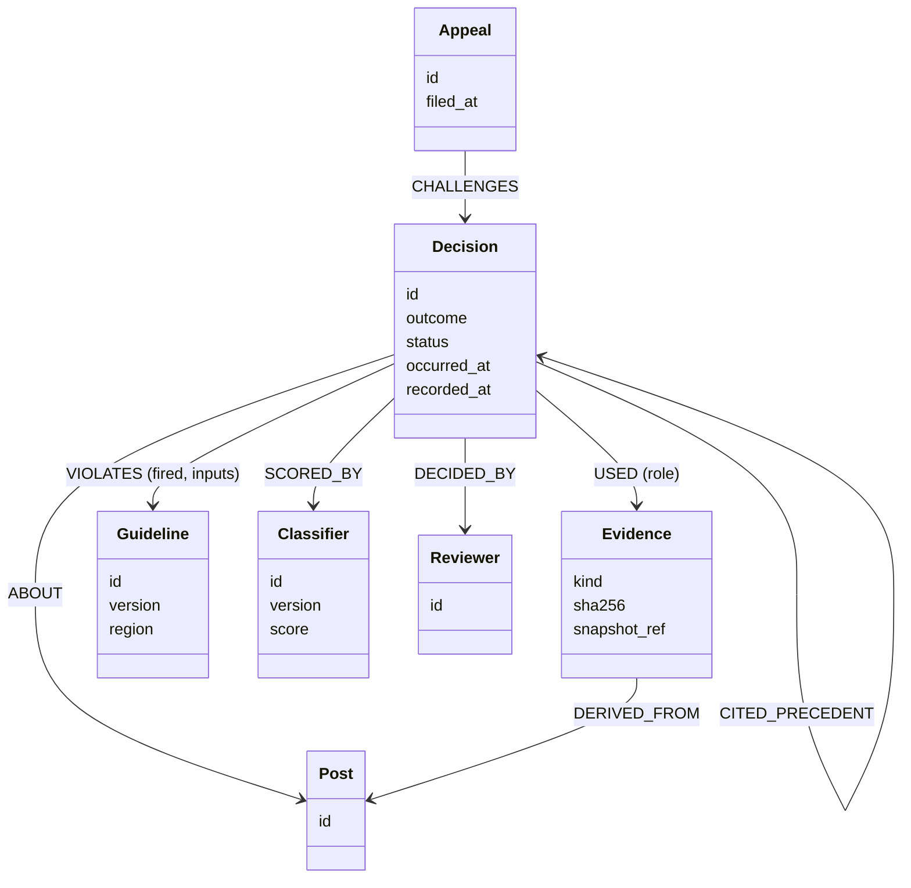

*[Knowledge Graphs: From Concept to Production](../README.md) · Day 20 of 23 · Arc 4 — Time, Procedure and Reason*

# Day 20 — Drill: Designing Decision Traces

> **Today's one idea:** Seven graded exercises on the arc's second bottleneck — deciding what a decision trace must capture so it can be audited, replayed and reused. No new concepts, no narrative.
> **Reading time:** ~45 min (exercises only) · **Prereqs:** [Day 16](day-16-temporal-graphs.md), [Day 17](day-17-procedural-graphs.md), [Day 19](day-19-context-graphs.md)
> **Primary source for today:** HL7 International. *FHIR R4: Provenance* resource. hl7.org/fhir/R4/provenance.html — the element table (`target`, `occurred`, `recorded`, `policy`, `reason`, `activity`, `agent`, `entity`, `signature`).
> **Before you start:** Recall Day 19's load-bearing idea — no looking. What are the two rules that make a decision trace trustworthy, and why does a bitemporal graph make a plain pointer to evidence safe?

---

**Your only support today — the trace checklist** (from Day 19):

| # | Field | The question it answers |
|---|---|---|
| 1 | Identity, type, status | Which decision, and is it still standing? |
| 2 | About (version-specific) | Decided about *what*, exactly? |
| 3 | Evidence, with roles | Based on what — *as it stood then*? |
| 4 | Procedure and policy version | Under which rules? |
| 5 | Rules evaluated and fired, with reasons | Why this outcome? |
| 6 | Exceptions and overrides | Where did we depart from the rules, and who allowed it? |
| 7 | Process: run, steps, tool calls | How? |
| 8 | Who: agent and version, model, approvers, on whose behalf | Who's accountable? |
| 9 | Occurred and recorded | When — in the world, and in the record? |
| 10 | Precedent cited, effects, supersession | How does it connect to other decisions? |

Two rules: **evidence as it stood then**, and **supersede, never edit**.

Attempt each exercise before opening the hint. If you get one wrong, redo it cold tomorrow.

---

## Exercise 1 — Fix an outcome-only trace (customer support) — *Day 17 callback*

A support platform logs this for every escalation:

```json
{"ticket": "T-4410", "action": "escalated_to_tier3", "at": "2026-04-02T10:14:00Z", "by": "bot"}
```

(a) Which checklist fields are missing? (b) Rewrite it as a trace (JSON is fine). (c) Which *Day 17* object must it link to so that an auditor can check the escalation followed the runbook?

<details>
<summary>Hint</summary>
"by: bot" — which bot, which version, running which procedure? And "escalated" — because of which rule, with which inputs?
</details>

<details>
<summary>Solution</summary>

(a) Missing: 2 (which ticket *version*), 3 (evidence), 4 (procedure and policy version), 5 (rule and inputs), 6 (any override), 7 (run), 8 (agent version, model, on whose behalf), 9 (only one timestamp), 10. Only the outcome and a vague actor survived.

(b)

```json
{
  "decision_id": "DEC-77120", "type": "escalation", "outcome": "tier3", "status": "accepted",
  "about": {"ticket": "T-4410", "ticket_version": 6},
  "evidence": [
    {"role": "source", "kind": "conversation_snapshot", "sha256": "9f2c…", "turns": [1, 14]},
    {"role": "source", "kind": "account_tier", "value": "enterprise", "read_known_at": "2026-04-02T10:13:58Z"}
  ],
  "procedure": {"name": "support_escalation", "version": 12},
  "rules": [
    {"id": "sla_breach_risk", "version": 3, "fired": true,  "inputs": "enterprise; open 26h > 24h"},
    {"id": "outage_keyword",  "version": 1, "fired": false, "inputs": "no incident match"}
  ],
  "overrides": [],
  "run": {"thread_id": "esc-T-4410-3", "steps": ["classify", "check_sla", "route_tier3"]},
  "agent": {"id": "support-bot", "version": "2.3.1", "model": "<model id>", "on_behalf_of": "Support Ops"},
  "occurred_at": "2026-04-02T10:14:00Z", "recorded_at": "2026-04-02T10:14:01Z",
  "supersedes": null
}
```

(c) The **run** — Day 17's `(:Run)-[:FOLLOWED]->(:Procedure)` and its `VISITED` steps. Without it the auditor can see *that* the rule fired but not whether the steps before it ran in order. Day 18's r2 showed why the run must also carry the state the guards read — here, the account tier and ticket age are in the evidence.
</details>

---

## Exercise 2 — Snapshot, pointer or hash? (insurance claims) — *Day 16 callback*

A claims decision used six pieces of evidence. For each, choose: **pointer + `known_at`** (read later through the bitemporal graph), **snapshot + hash**, or **hash only** — and justify in one line.

1. The claimant's address, stored in your bitemporal knowledge graph.
2. The policy wording PDF in the document store.
3. A third-party fraud score from an external API.
4. The live GBP/EUR exchange rate used to convert a European repair invoice.
5. The investigator's free-text notes, which contain medical details.
6. A photo of the damage, 8 MB, in object storage.

<details>
<summary>Hint</summary>
Ask two things for each item: can <em>you</em> reproduce what it said on the decision date? And should the full content sit in a widely readable trace?
</details>

<details>
<summary>Solution</summary>

| # | Choice | Why |
|---|---|---|
| 1 | **Pointer + `known_at`** | Your graph is bitemporal (Day 16), so "the address as known at decision time" is one query. Copying it would duplicate data you already version. |
| 2 | **Pointer + hash** (snapshot if the store isn't immutable) | The wording must be provably the one in force. A content hash proves it; an immutable, versioned store makes the pointer safe. |
| 3 | **Snapshot + hash** | You can't ask the vendor what it said last March. Store the score, its version and the response hash. |
| 4 | **Snapshot** (value + source + timestamp) | Exchange rates change by the second; the rate used *is* the evidence. |
| 5 | **Hash only, plus a pointer to the access-controlled record** | Medical details shouldn't be copied into a trace many people can query. The hash proves which notes were used without spreading them. |
| 6 | **Pointer + hash** | Too large to copy. The hash proves the photo wasn't swapped (it matters: Day 19's fraud case turned on a photo). |

The general rule: **snapshot what you can't reproduce; point (with `known_at` or a hash) at what you can; never copy what the trace's readers shouldn't see.**
</details>

---

## Exercise 3 — Replay under a policy change (underwriting)

Home-insurance pricing policy `UW-HOME` moved from **v3** to **v4** on 1 May: the flood-zone loading rule `flood_load` changed from "zone ≥ 3" to "zone ≥ 2". Every quote decision stores `(:Decision)-[:FOLLOWED]->(:Policy {id, version})` and `(:Decision)-[:EVALUATED {fired, inputs}]->(:Rule {id, version})`, and the property's flood zone is evidence.

(a) Write a query listing April decisions under v3 where `flood_load` **didn't fire** but **would have under v4**. (b) What would make this query impossible?

<details>
<summary>Hint</summary>
You need the input the rule read — the flood zone — at decision time. Where is it stored?
</details>

<details>
<summary>Solution</summary>

(a) Assuming each `EVALUATED` edge stores the zone as a number (`zone`) alongside `inputs`:

```cypher
MATCH (d:Decision)-[:FOLLOWED]->(:Policy {id: 'UW-HOME', version: 3})
MATCH (d)-[e:EVALUATED]->(:Rule {id: 'flood_load', version: 3})
WHERE d.occurred_at >= datetime('2026-04-01T00:00:00Z')
  AND d.occurred_at <  datetime('2026-05-01T00:00:00Z')
  AND e.fired = false
  AND e.zone >= 2            // v4's condition, applied to the input v3 actually saw
RETURN d.id, e.zone
```

This is **impact analysis**: how many past decisions would change under the new policy. Underwriters, regulators and product teams all ask it.

(b) Any of: no policy version on the decision, no rule version, or **no stored rule inputs**. If the trace says only "flood_load: not fired", you'd have to re-read each property's zone, and if the zone itself was later corrected you'd get the wrong answer unless you read it with `known_at` (Day 16). Storing *inputs*, not just results, is what makes a trace replayable.
</details>

---

## Exercise 4 — Model the exception (SaaS sales: the 20% discount)

Day 19's renewal: pricing rule `P-7` caps renewal discounts at 10%. Account manager Ana asked for 20% because of a three-day outage (incident `INC-2291`). The VP of Sales approved; Finance signed off.

(a) Write the Cypher for the decision, the exception, its justification and both approvals. (b) Write the query: "all exceptions to `P-7` in the last 12 months, with their justification and approvers."

<details>
<summary>Hint</summary>
An exception is a relationship between the decision and the rule it departed from — with its own properties. The justification is evidence, and it can point at something real.
</details>

<details>
<summary>Solution</summary>

(a)

```cypher
MATCH (c:Customer {id: 'ACME'}), (r:Rule {id: 'P-7', version: 2}), (inc:Incident {id: 'INC-2291'})
CREATE (d:Decision {id: 'D-3120', type: 'renewal_discount', outcome: '20%', status: 'accepted',
                    occurred_at: datetime('2026-03-14T00:00:00Z'), recorded_at: datetime()})
CREATE (d)-[:ABOUT]->(c)
CREATE (d)-[:EXCEPTION_TO {requested: '20%', limit: '10%'}]->(r)
CREATE (d)-[:JUSTIFIED_BY {summary: '3-day outage in Q1'}]->(inc)
MERGE (ana:Person {id: 'ana'})    CREATE (d)-[:REQUESTED_BY]->(ana)
MERGE (vp:Person  {id: 'vp-sales'}) CREATE (d)-[:APPROVED_BY {role: 'exception_approver', seq: 1}]->(vp)
MERGE (fin:Person {id: 'finance-1'}) CREATE (d)-[:APPROVED_BY {role: 'finance_signoff', seq: 2}]->(fin)
```

(b)

```cypher
MATCH (d:Decision)-[x:EXCEPTION_TO]->(:Rule {id: 'P-7'})
WHERE d.occurred_at > datetime() - duration('P12M') AND d.status = 'accepted'
OPTIONAL MATCH (d)-[:JUSTIFIED_BY]->(j)
OPTIONAL MATCH (d)-[a:APPROVED_BY]->(p)
WITH d, x, j, p, a ORDER BY a.seq
RETURN d.id, x.requested, labels(j)[0] + ' ' + j.id AS justification,
       collect(p.id + ' (' + a.role + ')') AS approvers
```

This is the query that stops the new account manager from offering 20% to a customer with no outage: an agent retrieving "how do we usually renew?" sees an *exception* with a *justification*, not a norm.
</details>

---

## Exercise 5 — Map a trace onto observability spans (agent platforms)

Your platform emits OpenTelemetry spans following the GenAI semantic conventions (status: *Development*): an `invoke_agent` span per agent run and an `execute_tool` span per tool call, with `gen_ai.agent.id`, `gen_ai.agent.version` and `gen_ai.conversation.id`.

(a) Which checklist fields can the spans supply, and which can't they? (b) The security team wants full prompts and tool results on every span "for debugging". What do the conventions say, and what do you do? (c) How do you link a `Decision` node to its spans?

<details>
<summary>Hint</summary>
Spans are built for <em>how long</em> and <em>did it fail</em>. Which of the ten fields is about <em>why</em>? And the conventions mark one class of attribute specially.
</details>

<details>
<summary>Solution</summary>

(a) Spans supply **7 (process)** — the run and its tool calls, with timings and errors — and part of **8** (agent ID and version, model) and **9** (when it happened). They don't supply **4–6** (policy, rules, exceptions), **3** as a snapshot (spans point, they don't freeze), **1/10** (status and supersession; spans are immutable and expire), or human approvers.

(b) The conventions make message content, system instructions and tool definitions **opt-in**, not on by default. Keep it off on always-on telemetry. Put the evidence the *decision* needs into the trace under its own access controls and retention policy, as snapshots or hashes (Exercise 2). Turn content capture on only for a named debugging session, with an expiry date.

(c) Store the identifiers both ways: `trace_id` and the root `span_id` as properties on the `Decision` (or its `Run`), and the `decision_id` as a span attribute. Then a reviewer can go from "why was this escalated?" (graph) to "why was it slow?" (tracing backend) and back. Two systems, one key.

`[VERIFY]` The exact attribute names for tool calls (`execute_tool`) are in `docs/gen-ai/` of the open-telemetry/semantic-conventions-genai repository; check them before building on them — the conventions are still in development.
</details>

---

## Exercise 6 — Map a clinical override onto FHIR Provenance (healthcare)

At 02:40 a sepsis early-warning model raised an alert for patient P-301. At 02:46 the night nurse overrode it, noting that the raised heart rate followed a dose of salbutamol. The note was saved at 03:15. Hospital protocol `SEP-ALERT` v5 allows a nurse override with a documented reason, reviewed by the on-call doctor by morning.

(a) Fill in the Provenance elements: `target`, `occurred`, `recorded`, `policy`, `reason`, `activity`, `agent` (with roles), `entity` (with roles). (b) The doctor *reads* the override at 07:00 and agrees. Does that create a new Provenance? (c) Which checklist field does FHIR Provenance leave to you?

<details>
<summary>Hint</summary>
Provenance is for creating or changing a record. What about reading one? And which of the ten fields is about <em>other decisions</em>?
</details>

<details>
<summary>Solution</summary>

(a)

| Element | Value |
|---|---|
| `target` | The alert-status resource for P-301, **version-specific** (the version created by the override) |
| `occurred` | 02:46 |
| `recorded` | 03:15 |
| `policy` | URI of protocol `SEP-ALERT` v5 |
| `reason` | Override: tachycardia explained by salbutamol administration |
| `activity` | Override of a clinical decision-support alert |
| `agent` | Nurse (role: author, `who` = the nurse); the ward/organisation as `onBehalfOf`; the sepsis model as a device agent that produced the alert |
| `entity` | The alert (role: source); the medication administration record for salbutamol (role: source); the prior alert-status version (role: revision) |
| `signature` | The nurse's, matching the author agent |

(b) Reading alone doesn't — FHIR uses **AuditEvent** for access, Provenance for changes. But the doctor *agreeing* is a decision in itself (the protocol requires a review), so it should create a new Provenance: target = the same alert status, activity = review, agent = the doctor, linked to the nurse's override. Two decisions, two traces.

(c) **Field 10, precedent.** FHIR records *this* change thoroughly but has no standard way to say "decided this way because of earlier override O-118". If you want precedent retrieval (tomorrow), you add that link yourself.
</details>

---

## Exercise 7 — Design for a domain you haven't seen (trust & safety: content moderation)

A platform removes posts that break its rules. Facts about the domain:
- Decisions are made by a classifier, a human reviewer, or both.
- The rules (the "community guidelines") change several times a year, and some apply only in certain countries because of local law.
- Users can appeal; an appeal can uphold or reverse the decision.
- The user may delete the post afterwards.
- Reviewers look at similar past cases to stay consistent.

(a) Draw the trace schema (Mermaid `classDiagram`). (b) Write three queries it must answer: one for an appeal reviewer, one for a regulator, one for the policy team. (c) Score your own design against the ten-field checklist. Which field was hardest?

<details>
<summary>Hint</summary>
Check what each fact implies: classifier versions; a rule version that is also region-scoped; appeals as supersession; deleted posts and evidence snapshots; similar cases and precedent links.
</details>

<details>
<summary>Solution</summary>

(a)



Key choices: the post's content is **snapshotted** (with a hash, under strict access control) at decision time, because the user may delete it — without that, an appeal or a regulator can't see what was judged. Guidelines are versioned **and region-scoped**, so the same post can break `G-12 v8 (DE)` and not `G-12 v8 (US)`. An appeal outcome is a **new decision** that `SUPERSEDES` the original (reversal) or links to it as upheld. Precedent is explicit: `CITED_PRECEDENT`.

(b)

```cypher
// Appeal reviewer: the original decision, the rule and version applied, the evidence, and the precedents cited
MATCH (d:Decision {id: $decision_id})-[v:VIOLATES]->(g:Guideline)
OPTIONAL MATCH (d)-[:CITED_PRECEDENT]->(p:Decision)
OPTIONAL MATCH (d)-[:USED]->(e:Evidence)
RETURN d.outcome, g.id, g.version, g.region, v.inputs, collect(DISTINCT p.id) AS precedents,
       collect(DISTINCT e.kind) AS evidence;

// Regulator: last quarter's removals in Germany, how many were automated, and how many were reversed on appeal
MATCH (d:Decision {outcome: 'removed'})-[:VIOLATES]->(:Guideline {region: 'DE'})
WHERE d.occurred_at >= datetime('2026-07-01T00:00:00Z') AND d.occurred_at < datetime('2026-10-01T00:00:00Z')
OPTIONAL MATCH (d)-[:DECIDED_BY]->(h:Reviewer)
OPTIONAL MATCH (rev:Decision {outcome: 'reinstated'})-[:SUPERSEDES]->(d)
RETURN count(DISTINCT d) AS removals,
       count(DISTINCT CASE WHEN h IS NULL THEN d END) AS fully_automated,
       count(DISTINCT rev) AS reversed_on_appeal;

// Policy team: which guideline versions are reversed most often on appeal
MATCH (rev:Decision)-[:SUPERSEDES]->(d:Decision)-[:VIOLATES]->(g:Guideline)
RETURN g.id, g.version, count(*) AS reversals ORDER BY reversals DESC LIMIT 10;
```

(c) Check each of the ten fields. Most people find **3 (evidence as it stood then)** hardest here — deleted posts force a snapshot, and a snapshot of harmful content is itself sensitive. The usual answer is a snapshot in a restricted store, a hash in the trace, and a retention period set by law. The runner-up is **4**: a rule that has both a version *and* a region.
</details>

---

**Transfer — apply it:**

> Name a situation from your own domain or current work where today's concept applies. Write one concrete sentence: what the input is, what today's idea does to it, and what the output is. If nothing comes to mind in 60 seconds, that is the signal — re-read the hook and try again.
>
> *Example shape:* "Our FraudOps AI summary currently stores only the generated text; running it against the ten-field checklist shows it's missing the playbook version, the rules that fired and the cited pages as snapshots — adding those turns each summary into a trace an auditor can follow and the next investigator can retrieve."

---

## Suggested readings for today

**Required if you have 15 extra minutes:** HL7 FHIR R4 Provenance — hl7.org/fhir/R4/provenance.html — read the element table and the **"Provenance vs. AuditEvent"** guidance on the same page. Then reread your Exercise 7 schema: which FHIR element would have saved you a design decision?

**If you want the deep version:**
- W3C, *PROV-DM: The PROV Data Model*, W3C Recommendation, 30 April 2013 — w3.org/TR/prov-dm/ — the conceptual model behind PROV-O, including **qualified relations** (how to attach a role, a plan or a time to an association). `[VERIFY section numbers]` This is how you'd make Exercise 4's approval chain standards-compliant.
- Consumer Financial Protection Bureau. *Circular 2022-03: Adverse action notification requirements in connection with credit decisions based on complex algorithms.* 26 May 2022 — consumerfinance.gov — short, and the clearest statement anywhere of why a trace must store *specific reasons*, not a score.
- OpenTelemetry, *Semantic conventions for GenAI agent spans* (Development) — github.com/open-telemetry/semantic-conventions-genai, `docs/gen-ai/gen-ai-agent-spans.md` — read the difference between `invoke_agent` (the LLM drives control flow) and `invoke_workflow` (the application does). That's Day 17's distinction, written into a telemetry standard.

---

← [Day 19 — Context Graphs](day-19-context-graphs.md) &nbsp;|&nbsp; [Day 21 — Precedent →](day-21-precedent-retrieval.md)
