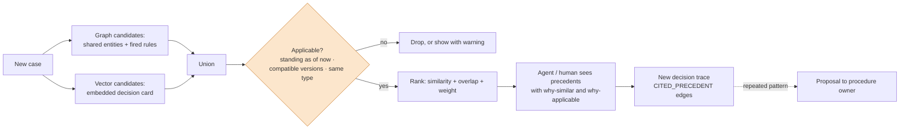

*[Knowledge Graphs: From Concept to Production](../README.md) · Day 21 of 23 · Arc 4 — Time, Procedure and Reason*

# Day 21 — Precedent: Retrieving How We Decided Before

> **Today's one idea:** A precedent is a past decision that is both *similar* and *still applicable*: find candidates by graph neighbourhood and embeddings, keep only those still standing under comparable rules, and when the same trace keeps repeating, propose it as a procedure.
> **Reading time:** ~40 min · **Prereqs:** [Day 9](day-09-graphrag.md), [Day 11](day-11-kg-embeddings.md), [Days 16–20](day-16-temporal-graphs.md)
> **Primary source for today:** Zhao, Andrew, et al. "ExpeL: LLM Agents Are Experiential Learners." AAAI 2024. arXiv:2308.10144 — the method: gathering experiences, extracting insights, and retrieving successful past trajectories at task time.
> **Before you start:** Recall Day 20's Exercise 2 — no looking. What's the general rule for when to snapshot evidence, when to point at it, and when to store only a hash?

---

## The hook (2–4 min)

A claims agent gets a new refund request: a £620 designer lamp, "arrived in pieces", photo attached. It looks for how the company handled similar cases before, using vector search over past decision summaries. The top three matches:

1. **D-501** — £640 lamp, "arrived in pieces", photo, refunded after team-lead approval. Similarity 0.96.
2. **D-188** — £610 lamp, damaged, refunded automatically. Similarity 0.94. *Decided in 2025, when the approval threshold was £1,000.*
3. **D-3120** — a 20% renewal discount. Similarity 0.41. *An approved exception.*

The agent's plan: "Precedent D-501 and D-188 show we refund these. Proceed."

Both are the wrong precedent. D-501 was **superseded** three weeks later — the photo came from a stock-image site (Day 19). D-188 was decided under **rules that no longer exist**. The most *similar* decisions were the least *applicable* ones. And if D-3120 had scored a little higher, the agent might have concluded that 20% discounts are normal.

Lawyers have a name for this mistake: citing a case that is no longer good law.

---

## Building the intuition (10–15 min)

### A lawyer's three questions

Before a lawyer relies on an earlier case, they ask three questions — in this order:

1. **Is it on point?** Are the facts similar in the ways that *matter*? Not "both are about lamps", but "both involve damage evidence of the same kind, of a similar value".
2. **Is it still good law?** Has it been overruled? Has the statute it applied been amended since? Legal research tools exist largely to answer this: they flag cases that later courts have overruled or questioned.
3. **How much weight does it carry?** A supreme-court decision binds; a lower-court decision persuades. A decision checked by a senior reviewer carries more weight than one made by a bot alone.

Vector search answers only the first question, and only roughly — it finds similar *wording*. The hook's agent asked one question out of three.

### Mapping the questions to the graph

Everything you need for questions 2 and 3 is already in the graph, because of the last five days:

| Lawyer's question | Graph answer | Built on |
|---|---|---|
| On point? | Shared entities and fired rules (graph) + similar decision summary (embedding) | Days 9, 11, 19 |
| Still good law? | Not superseded as of now; procedure and rule versions compatible with today's | Days 16, 17, 19 |
| How much weight? | Confirmed by a human? Outcome later upheld? Cited by other decisions? | Days 19, 20 |

Run the hook's three matches through it:

- **D-501:** on point ✓ — good law ✗ (superseded by D-502). **Excluded.**
- **D-188:** on point ✓ — good law ✗ (procedure v0, threshold £1,000; today's threshold rule is v2). **Excluded**, or shown only with a warning that the rule has changed.
- **D-3120:** on point ✗ (different decision type). If it were on point, its weight would come from an *exception*, so it would be shown as "an exception, justified by an outage" — not as the norm.

The agent is left with fewer precedents, and they're all ones it can safely cite. That's the trade: fewer, applicable results instead of many similar ones.

### When precedents pile up

Suppose that over six months, forty standing decisions all follow the same path: *damaged, photo provided, £300–£500, team lead approves*. The team lead never refused once. That's information about the procedure, not just about the cases: perhaps approval for that band is a rubber stamp. Agent-memory research turns this pattern into a mechanism. **Agent Workflow Memory** induces reusable workflows from successful past runs; **Memp** builds, retrieves, updates and deprecates procedural memory distilled from past trajectories.

In an organisation, the induced workflow is a **proposal to the procedure owner**, not an automatic change. Silently changing the procedure because precedents suggest it would be [Day 18's Exercise 3](day-18-drill-sop-to-procedure-graph.md) error again — inventing policy.

---

## The formal picture (10–15 min)

### The pipeline



**1. Candidates from two sources.** *Graph candidates* are decisions of the same type that share entities with the new case (same provider, same garage, same phone — Day 9's local neighbourhood) or that fired the same rules. *Vector candidates* come from an embedding of a **decision card** — a short, structured text written for every decision: type, outcome, rules fired, key evidence kinds, amounts. Embed the card, not the raw chat log: you want the cards to be similar when the *cases* are similar, not when the customers write in the same style.

**2. Applicability filter** — question 2, always applied *before* ranking:
- **Standing:** recorded by `as_of` and not superseded by any decision recorded by `as_of` (Day 19, Exercise 3).
- **Compatible rules:** same procedure, and every rule it fired is in a version whose logic is unchanged today — or flagged as "decided under different rules".
- **Same decision type.**

**3. Rank** — combine similarity and weight: cosine similarity of the cards, share of today's fired rules that the precedent also fired, shared entities, and a weight term (human-confirmed, later upheld, cited by others). The weights are a starting point; tune them on pairs your reviewers have labelled "good precedent / bad precedent".

**4. Cite.** The new decision's trace gets `CITED_PRECEDENT` edges — field 10 from Day 20 — so a reviewer can see what the agent relied on, and so a precedent that's later overturned can be traced to everything that relied on it.

**5. Promote** — offline: group standing decisions by `(procedure version, path, rules fired, outcome)`, and when a group is large and uniform, generate a proposal for the procedure owner, linked to the decisions that support it.

### Building it in Neo4j

A vector index over decision cards (Neo4j 5.11+), then one query that does candidates, applicability and ranking:

```cypher
// once: index the embedded decision cards (384 dimensions for a small sentence-embedding model)
CREATE VECTOR INDEX decision_card IF NOT EXISTS
FOR (d:Decision) ON d.card_embedding
OPTIONS {indexConfig: {`vector.dimensions`: 384, `vector.similarity_function`: 'cosine'}};
```

```cypher
// precedents for a new case
CALL db.index.vector.queryNodes('decision_card', 50, $card_vec) YIELD node AS d, score AS text_sim
WHERE d.type = $type
  AND d.recorded_at <= $as_of
  AND NOT EXISTS {                                   // still good law
    MATCH (s:Decision)-[:SUPERSEDES]->(d) WHERE s.recorded_at <= $as_of
  }
MATCH (d)-[:FOLLOWED]->(p:Procedure {name: $procedure})
WHERE p.version IN $compatible_versions              // decided under comparable rules
OPTIONAL MATCH (d)-[:EVALUATED {fired: true}]->(r:Rule) WHERE r.id IN $fired_now
WITH d, text_sim, p, count(DISTINCT r) AS shared_rules
OPTIONAL MATCH (d)-[:ABOUT]->()--(x) WHERE x.id IN $context_ids
WITH d, text_sim, p, shared_rules, count(DISTINCT x) AS shared_entities
OPTIONAL MATCH (d)-[:APPROVED_BY]->(h:Person)
WITH d, text_sim, p, shared_rules, shared_entities, count(h) > 0 AS human_confirmed
RETURN d.id, d.outcome, p.version, round(text_sim, 2) AS text_sim, shared_rules, shared_entities,
       human_confirmed,
       0.5 * text_sim
     + 0.3 * toFloat(shared_rules) / CASE size($fired_now) WHEN 0 THEN 1 ELSE size($fired_now) END
     + 0.1 * CASE WHEN shared_entities > 3 THEN 1.0 ELSE shared_entities / 3.0 END
     + 0.1 * CASE WHEN human_confirmed THEN 1.0 ELSE 0.0 END AS score
ORDER BY score DESC
LIMIT 5
```

Run on the hook's case: D-501 is removed by the `SUPERSEDES` filter, D-188 by the version filter, and D-3120 by the type filter. What's left is short, and every result can be cited.

To get graph-only candidates that the vector search missed (for example, a past decision that involved the *same garage* but was described differently), run a second query starting from `$context_ids` and merge the two lists in Python before ranking.

### Same idea, six real systems

| System | Domain | What it retrieves | What it shows |
|---|---|---|---|
| **CourtListener** (Free Law Project) | Law | Citation graph: citing opinion → cited opinion, with citation depth | The citation graph exists — but it has no "overruled / followed" field, so you'd have to add the "still good law?" signal yourself |
| **PlayerZero** | Production software support | Past incidents and fixes with their "why", evidence and outcomes | Precedent for engineers: "this has happened before, here's what fixed it" (vendor's description) |
| **`neo4j-agent-memory`** | Agent memory | Similar past reasoning traces | Precedent retrieval as a library feature `[VERIFY method names in the reference docs]` |
| **ExpeL** (Zhao et al., 2024) | Agent research | Successful past trajectories + insights distilled from successes and failures | Agents improve from experience without weight updates |
| **Agent Workflow Memory** (Wang et al., 2024) | Web agents | Workflows induced from past runs, offline or online | Repeated traces become reusable procedures |
| **Memp** (Fang et al., 2025) | Agent research | Procedural memory built from trajectories, then updated and deprecated | Procedures need maintenance and retirement too — exactly Day 16's lesson |

---

## Where it breaks / what it is not (3–5 min)

**Similar text isn't the same case.** "Lamp arrived in pieces" matches a fraud case and a genuine one equally well. That's why graph overlap (shared rules, shared entities) gets weight alongside text similarity, and why the decision card is structured.

**Exceptions become norms.** The 20% discount is the classic case of an exception treated as precedent. Retrieve exceptions *labelled as exceptions*, show their justification, and require the new case to share the justification (an outage) before the exception applies to it.

**Agents citing themselves.** If an agent's decisions become precedents for the same agent, small errors compound: one bad call becomes a pattern. Give human-confirmed and later-upheld decisions more weight, and watch for long chains of bot-only citations.

**Vector filters run after the top-k.** `queryNodes('…', 50, …)` returns 50 nodes *before* your `WHERE` clauses. If most are filtered out, you may end up with very few precedents. Retrieve more than you need, or pre-partition the index (for example, one index per decision type).

**Precedent crosses boundaries it shouldn't.** In a multi-tenant system, a decision made for one customer's tenant must never be retrieved as precedent for another — it leaks their data and their policies. Tenant ID belongs in the applicability filter, not in a comment.

**Overturning is a dependency problem.** When D-501 is superseded, every decision that cited it may need review. With `CITED_PRECEDENT` edges that's one query; without them, it's impossible.

**Promotion isn't learning.** Forty uniform decisions are evidence for a procedure change, not the change itself. The owner may know something the decisions don't — a regulator's view, an upcoming audit.

---

## Try it yourself (5–10 min)

### Exercise 1 — Retrieval (close the page first)

Without looking: (a) state the lawyer's three questions and which part of the pipeline answers each; (b) give the two reasons the hook's top match D-501 must not be returned, and the one reason D-188 must not be; (c) say what goes into a decision card and why you don't embed the raw conversation.

<details>
<summary>Hint</summary>
On point, good law, weight. Then think about what changed after D-501 and what changed since D-188.
</details>

<details>
<summary>Solution</summary>

(a) **On point** — candidates from graph overlap and card embeddings. **Still good law** — the applicability filter: standing as of `as_of`, compatible procedure and rule versions, same type. **Weight** — the ranking terms: human-confirmed, upheld, cited.

(b) D-501 was **superseded** by D-502 (fraud confirmed), so it's not standing — and its outcome turned out to be wrong, so even as a pattern it would teach the agent the wrong thing. D-188 was decided under **incompatible rules** (a £1,000 threshold).

(c) Type, outcome, rules fired, evidence kinds, key amounts, procedure version — a structured summary. Raw conversations make cases look similar when customers *write* alike, not when the *cases* are alike, and they carry personal data into the index.
</details>

### Exercise 2 — Direct application: incident precedents (IT operations)

A payments service is throwing timeouts after a deploy. Your graph holds past incident decisions, each with `type: 'incident_remediation'`, `FOLLOWED` a runbook version, `EVALUATED` rules (e.g. `recent_deploy`, `db_conn_saturation`), `ABOUT` a `Service`, and `SUPERSEDES` when a postmortem found the first fix wrong.

The precedent query returns these candidates. Which would you show the on-call engineer, in what order, and with what warning?

| Candidate | Text sim | Same service? | Rules shared (of 2) | Standing? | Runbook version | Human confirmed |
|---|---|---|---|---|---|---|
| I-77 "rollback deploy" | 0.91 | yes | 2 | yes | v7 (current) | yes |
| I-52 "raise DB pool size" | 0.89 | yes | 1 | **superseded** by I-53 | v6 | yes |
| I-53 "fix connection leak, revert pool change" | 0.71 | yes | 1 | yes | v6 | yes |
| I-90 "rollback deploy" | 0.93 | **no** (search service) | 1 | yes | v7 | no |

<details>
<summary>Hint</summary>
I-52 and I-53 are a pair: what does the supersession tell the engineer that neither decision tells them alone? And runbook v6 vs v7 — compatible, or not?
</details>

<details>
<summary>Solution</summary>

Show **I-77 first**: same service, both rules shared, standing, current runbook, human-confirmed. It's the strongest precedent on every question.

Show **I-53 second, with I-52 attached as context**: "Last time the pool size was raised (I-52), and that was reversed (I-53) because the real cause was a connection leak." Hide I-52 as a precedent, but its supersession is the most useful warning in the list: *don't just raise the pool size*. Flag that both were under runbook v6; check whether v7 changed the relevant steps.

Show **I-90 last or not at all**: highest text similarity, but a different service, one shared rule and no human confirmation. Text similarity was the only thing it had going for it.

The general point: a superseded decision isn't a precedent, but the *supersession* itself is often the best evidence you have.
</details>

### Exercise 3 — Stretch: propose, don't promote (customer support) — *Day 17 callback*

(a) Write a Cypher query that finds groups of **standing** refund decisions under the current procedure version that share the same visited path and fired rules, with at least 30 members and **zero** rejections at the team-lead step. (b) Write the Cypher that records a `ProcedureChangeProposal` for the owner, linked to the supporting decisions. (c) Why must the proposal not change the procedure directly?

<details>
<summary>Hint</summary>
Use Day 17's run schema: <code>(:Decision)-[:RAN_AS]->(:Run)-[:VISITED {seq}]->(:Step)</code>. A path is the list of step names ordered by <code>seq</code>; build it with <code>collect</code> after ordering.
</details>

<details>
<summary>Solution</summary>

(a)

```cypher
MATCH (d:Decision {type: 'refund'})-[:FOLLOWED]->(p:Procedure {name: 'refund', version: $current})
WHERE NOT EXISTS { MATCH (:Decision)-[:SUPERSEDES]->(d) }
MATCH (d)-[:RAN_AS]->(run:Run)-[v:VISITED]->(s:Step)
WITH d, s.name AS step, v.seq AS seq ORDER BY seq
WITH d, collect(step) AS path
OPTIONAL MATCH (d)-[:EVALUATED {fired: true}]->(r:Rule)
WITH d, path, apoc.coll.sort(collect(r.id)) AS rules      // or sort client-side if APOC isn't installed
WITH path, rules, collect(d) AS decisions
WHERE size(decisions) >= 30
  AND 'lead_approval' IN path
  AND none(x IN decisions WHERE x.outcome STARTS WITH 'declined')
RETURN path, rules, size(decisions) AS n, [x IN decisions | x.id][..5] AS examples
```

(b)

```cypher
MATCH (p:Procedure {name: 'refund', version: $current})
CREATE (prop:ProcedureChangeProposal {
  id: $proposal_id, status: 'open', created_at: datetime(),
  summary: 'Team lead approved all ' + toString(size($decision_ids)) +
           ' damaged-with-photo refunds in the £300–£500 band; consider removing approval for this band.'})
CREATE (prop)-[:PROPOSES_CHANGE_TO]->(p)
WITH prop
UNWIND $decision_ids AS did
MATCH (d:Decision {id: did})
CREATE (prop)-[:SUPPORTED_BY]->(d)
```

(c) Because the decisions can only show what happened, not why the rule exists. The approval step may be a control the auditors require, or a deterrent that works *because* it's there. Fraudsters may also learn the band. The owner decides; if they accept, the change becomes procedure **v3** with a valid-from date (Day 16), and every future decision records it (Day 19). The proposal and its supporting decisions stay as the trace of *that* decision.
</details>

### Exercise 4 — Spaced callback: as-of precedent and two kinds of embedding (Day 16, Day 11)

(a) An auditor reviews decision D-640, made on 10 March, which cited D-501 as precedent. D-501 was superseded on 24 March. Was the agent wrong to cite it? Write the parameter values you'd run the precedent query with to check. (b) [Day 11](day-11-kg-embeddings.md) taught KG embeddings like TransE. Could you use TransE instead of text embeddings of decision cards? What would each be good at?

<details>
<summary>Hint</summary>
(a) is Day 16's fairness rule: judge a decision by what was knowable when it was made. (b) What does TransE learn from — and what question does it answer well?
</details>

<details>
<summary>Solution</summary>

(a) No. On 10 March D-501 was standing, so citing it was correct *at the time*. Check by running the query with `$as_of = 10 March`: if D-501 comes back, the agent behaved correctly. Separately, D-501's supersession means D-640 should be **flagged for review** now — the precedent it relied on fell. With `CITED_PRECEDENT` edges that's `MATCH (x:Decision)-[:CITED_PRECEDENT]->(:Decision {id: 'D-501'}) RETURN x.id`.

(b) TransE learns from the *graph structure* — triples like `(D-501, FIRED, amount_over_500)` and `(D-501, ABOUT, A-1)` — so decisions that sit in similar positions in the graph get similar vectors, whatever words describe them. That makes it good at **structural similarity** and at **predicting a missing link**: "which outcome usually goes with this pattern of rules and entities?" Text embeddings of decision cards are good at similarity of *description*, and they're cheap to update for a brand-new decision. TransE has to be retrained, or extended inductively, before a new node gets a useful vector. In practice: use cards for retrieval now; consider structural embeddings later as an extra ranking signal, measured on reviewer-labelled pairs.
</details>

**Transfer — apply it:**

> Name a situation from your own domain or current work where today's concept applies. Write one concrete sentence: what the input is, what today's idea does to it, and what the output is. If nothing comes to mind in 60 seconds, that is the signal — re-read the hook and try again.
>
> *Example shape:* "When an SIU investigator opens a new staged-accident case, the input is the claim's subgraph and fired red flags; precedent retrieval returns past SIU decisions in the same tenant that share the garage or clinic, are still standing and were decided under the current playbook, and the output is three citable precedents — with the overturned ones shown as warnings, not examples."

---

## Connect it back

The arc is now complete. [Day 16](day-16-temporal-graphs.md) made the graph remember what it believed; [Day 17](day-17-procedural-graphs.md) made agents follow known routes; [Day 19](day-19-context-graphs.md) recorded why each decision was made. Today those three layers became something an agent can *use*. A precedent is a Day 19 trace, filtered by Day 16's clocks and Day 17's procedure versions, retrieved with Day 9's neighbourhoods and Day 11's embeddings. And when precedents pile up, they feed back into Day 17's procedures — through a person.

Tomorrow you rebuild the whole arc from memory. The day after, you build it into your Day 15 system.

**The question you can answer now that you couldn't yesterday:** the most similar past decision says "approve" — what three things must be true before your agent is allowed to rely on it?

---

## Suggested readings for today

**Required if you have 15 extra minutes:** Zhao et al., "ExpeL: LLM Agents Are Experiential Learners," arXiv:2308.10144 (AAAI 2024) — read the **method** section: how experiences are gathered, how insights are extracted by comparing successes with failures, and how successful trajectories are retrieved for a new task. Then compare: ExpeL retrieves by similarity alone. What would it gain from today's "still good law?" filter?

**If you want the deep version:**
- Wang, Zora Zhiruo, Jiayuan Mao, Daniel Fried, and Graham Neubig. "Agent Workflow Memory." arXiv:2409.07429, 2024 — how workflows are induced from past runs, offline from training examples or online from test queries. This is Exercise 3's promotion step, automated. Notice what's missing from the paper: an owner who approves the change.
- Fang, Runnan, Yuan Liang, Xiaobin Wang, et al. "Memp: Exploring Agent Procedural Memory." Findings of ACL 2026. arXiv:2508.06433 — procedural memory that's built, retrieved, *updated and deprecated*. Read the update and deprecation strategies with Day 16 in mind.
- Free Law Project, *CourtListener REST API v4: Citations* — wiki.free.law/c/courtlistener/help/api/rest/v4/citations — a real, large precedent graph (citing → cited, with depth). Design exercise: what extra fields would it need to answer "is this still good law?"
- Tomicevic, Dominik (CEO, Memgraph). "Contexts graphs, AI memory, and enterprise knowledge: Are decision traces enough?" *(headline as published)* InfoWorld, 19 May 2026 — the strongest critique of precedent-as-memory: traces without facts, procedures, permissions and time can't verify anything. After today you can check whether your stack answers it.

---

← [Day 20 — Drill: Designing Decision Traces](day-20-drill-decision-traces.md) &nbsp;|&nbsp; [Day 22 — Rest & Synthesize III →](day-22-rest-and-synthesize-iii.md)
