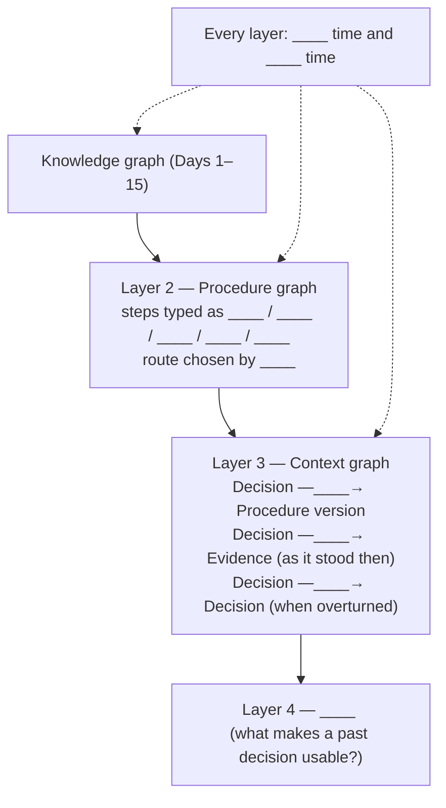
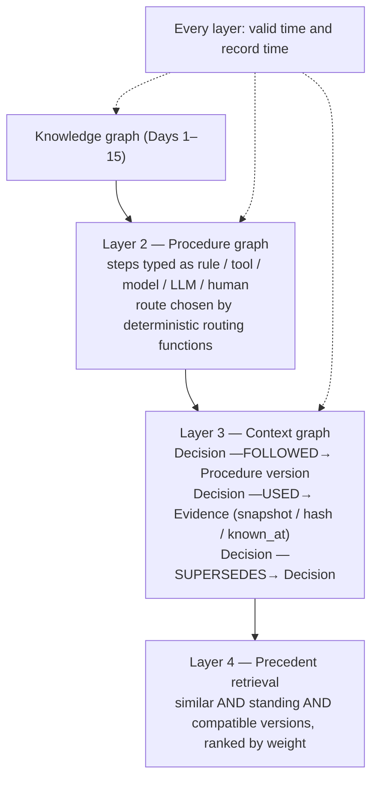

*[Knowledge Graphs: From Concept to Production](../README.md) · Day 22 of 23 · Arc 4 — Time, Procedure and Reason*

# Day 22 — Rest & Synthesize III

> **Today:** No new concepts. Only consolidation of the time–procedure–reason arc.
> **Format:** Re-state → Re-derive → Full run → Quiz
> **Reading time:** ~35 min (longer if gaps surface — that's the point)
> **Prereqs:** [Days 16–21](../README.md)

Days 16–21 added three layers to your knowledge graph and one way to use them together. Today checks they hold up without the pages in front of you, before the capstone asks you to build all four into one system.

Close all previous pages. Work from memory first.

---

## Step 1 — Re-state the six arc ideas (5 min)

> **Why this table is not in day order:** Recalling Day 16 first, then Day 17 lets you use sequence as a cue — which is how you memorised it, not how you'll use it. The scrambled order below forces you to retrieve each concept on its own merits. This discomfort is the point.

Write one sentence for each without looking anything up. Do them in the order given — resist the urge to reorder:

| Concept (Day N) | Your sentence |
|-----------------|--------------|
| What makes a past decision a usable precedent (Day 21) | |
| Who decides the route in a procedure graph, and what the LLM may write (Day 17) | |
| The two rules that make a decision trace trustworthy (Day 19) | |
| The two clocks, and the one write you're allowed to make to an existing version (Day 16) | |
| When to snapshot evidence, point at it, or store only a hash (Day 20) | |
| The property every junction's guards must have, and how you check a graph against reality (Day 18) | |

Compare to these

1. **Precedent (Day 21):** a past decision that's similar (graph overlap + embedded decision card) *and* still applicable — standing as of now, decided under compatible procedure and rule versions — ranked by weight; repeated patterns become proposals to the procedure owner, not automatic changes.
2. **Route in code (Day 17):** deterministic routing functions read the state and pick the next step; an LLM step may only write state fields, ideally from a fixed vocabulary — never the next step.
3. **Trustworthy traces (Day 19):** evidence *as it stood then* (snapshot, hash, or a bitemporal read), and *supersede, never edit*.
4. **Two clocks (Day 16):** valid time (when true in the world) and record time (when the graph believed it); the only write to an existing version is setting its `expired_at` — retire, never rewrite.
5. **Evidence (Day 20):** snapshot what you can't reproduce; point (with `known_at` or a hash) at what you can; never copy what the trace's readers shouldn't see.
6. **SOP → graph (Day 18):** guards complete and mutually exclusive at every junction, with the boundary convention written down; check against reality by replaying past runs — structurally (edges) and against the guards (state).

---

## Step 2 — Re-derive the stack (10 min)

Fill each blank from memory. Every blank is labelled with what it asks for.

Filled-in diagram

**Questions to answer without looking:**

1. On 10 March you learn that Alice moved to DeepMind effective 1 March. Which versions do you retire and which do you write — and what goes wrong if you just set `valid_to` on the existing edge?
2. A LangGraph human-approval node sends a notification email and then calls `interrupt()`. What happens when the approver answers, and how do you fix it?
3. Why does a decision trace store rules that *didn't* fire?
4. In conformance checking, what can a pure edge check never catch, and what must a run record so you can catch it?
5. Why is the applicability filter applied *before* ranking in precedent retrieval, not after?

Answers

1. Retire the current NTU version (`expired_at = 10 Mar`); write NTU `[1 Jan, 1 Mar)` and DeepMind `[1 Mar, …)`, both `recorded_at = 10 Mar`. Setting `valid_to` in place rewrites the past: the 5 March "edition" would now claim you already knew she'd left.
2. The node re-runs from its first line on resume, so the email is sent again. Move the side effect into its own node before the gate (and make it idempotent).
3. "The age rule was checked and passed" is part of the reason for the outcome — and you need the inputs those rules read to replay the decision under a new policy (Day 20, Exercise 3).
4. A move that exists in the graph but whose guard was false in that state (Day 18's r2: prod expansion without owner approval). The run must record the state its guards read, not just the path.
5. Because similarity and applicability are independent: the most similar decision is often the least applicable (the hook's D-501). If you rank first and filter afterwards, you can end up with a short list that's empty or padded with weak matches — and you've already spent your top-k on decisions you can't cite.

---

## Step 3 — Run it (10 min)

In a scratch Neo4j database, rebuild the arc end to end, from memory where you can. Tick each step; if any fails or you go blank, that's your diagnostic — revisit that day's exercises (not its reading) before Day 23.

- [ ] **Two clocks:** write Alice's four `WORKS_AT` versions and run the as-of query with three `(valid_at, known_at)` pairs. You should get NTU, Stanford, NTU. *(Day 16)*
- [ ] **Procedure:** build a four-step LangGraph with one rule junction and one `interrupt()` gate; run it twice so that each run takes a different branch, with a checkpointer and `thread_id`. *(Day 17)*
- [ ] **Conformance:** write `EDGES` for your four-step graph and check two runs, one of which you deliberately break. *(Day 18)*
- [ ] **Trace:** for one run, write a `Decision` with `FOLLOWED` (procedure version), `USED` (one snapshot with SHA-256), `EVALUATED` (one fired, one not), and `APPROVED_BY`. *(Days 19–20)*
- [ ] **Supersede:** overturn it with a second decision and run the "standing as of" query for a date before and after. *(Day 19)*
- [ ] **Precedent:** add three more decisions (one superseded, one under an older procedure version) and run a precedent query that returns only the applicable one. *(Day 21)*

---

## Step 4 — Quiz (5 min)

> **Why the questions jump around:** Questions in day order let you answer by position. The questions below deliberately cross concept boundaries. Answer each cold.

Answer before looking:

1. Your precedent search returns a decision that's highly similar and still standing, but it was an approved *exception* to a pricing rule. How should the agent treat it?
2. A hospital corrects an allergy record two weeks after a prescription. To judge the prescriber fairly, which `(valid_at, known_at)` do you query with — and why that one?
3. A credit decision trace stores "declined — score 612 < 640". What's missing for an adverse-action notice, and where does it come from?
4. A runbook change on 1 June adds a fraud review for claims over £10k. A claim run started on 31 May is waiting for approval on 2 June. What must the run record, and what must its decision trace link to?
5. **Cross-concept:** An auditor asks, "On 20 May, why did your agent fast-track claim C-1042, and would it be fast-tracked today?" Name every piece of the arc you need to answer both halves, and say which day each comes from.

Answers

1. As an exception, not a norm: show it with its justification (e.g., the outage incident) and only treat it as applicable if the new case shares that justification. Never let it pass as "how we usually do it". *(Days 20, 21)*
2. `valid_at = known_at = prescription date`. You judge a decision by what was knowable when it was made; today's corrected record answers a different question (was there clinical harm?). *(Day 16)*
3. The specific principal reasons, ranked — e.g., high utilisation, recent missed payments — stored at decision time with the model version that produced them. A score isn't a reason. *(Days 19, 20)*
4. The run must record which procedure version it was held to (pinned at start, or at decision time — a deliberate choice). The decision trace must link `FOLLOWED` to that version so an auditor can see which rules applied. *(Days 16, 17, 19)*
5. **First half (why on 20 May?):** the decision trace for C-1042 (Day 19), with the evidence read `known_at = 20 May` (Day 16), the procedure version and the branch it took — e.g., fraud score under 30 → fast-track (Day 17), and the rules evaluated with their inputs (Day 20). **Second half (today?):** replay the stored rule inputs, read with `known_at = now` (Day 16), against today's procedure version (Days 17, 20 Exercise 3), and check whether anything since — a supersession of C-1042's decision, a new flag on the provider — changes the outcome (Days 19, 21). Neither half is possible without both clocks, the procedure version and the stored rule inputs.

---

## What's ahead

| Day | Topic | What you'll decide or build |
|---|---|---|
| 23 | **Capstone II** | Extend your Day 15 graph with bi-temporal edges, a procedure graph compiled from a real SOP, decision traces and precedent retrieval — and pass the arc's audit question |

Today closes the gap between knowing each layer and holding all of them in your head at once — tomorrow you need all of them at once.

---

## Connect it back

The arc gave your knowledge graph a memory of its own past (Day 16), a fixed way of acting (Days 17–18), a record of its reasons (Days 19–20) and a way to learn from them safely (Day 21). The single question you carry into the capstone: **can your agent explain any past decision using only what it knew at the time — and say whether it would decide the same way today?**

---

← [Day 21 — Precedent](day-21-precedent-retrieval.md) &nbsp;|&nbsp; [Day 23 — Capstone II →](day-23-capstone-ii.md)
